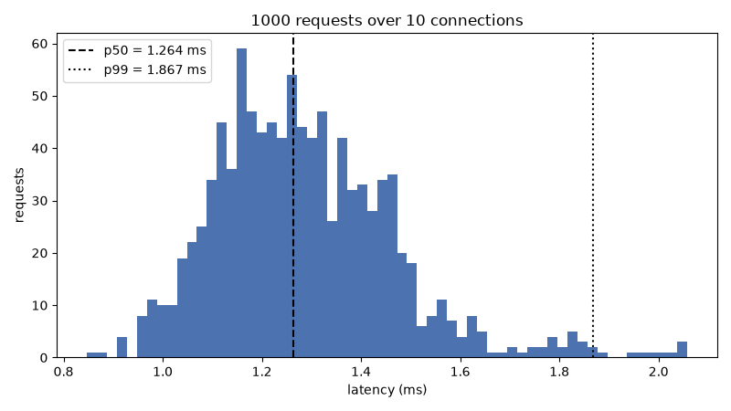
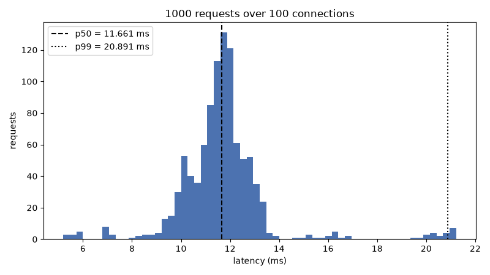

# 09 1,000 requests and a latency plot

> Module: Python and the internet from zero · Time: ~5 h · Builds on: 04, 07, 08

## The problem

"Is it fast?" has no answer until you measure, and measuring has traps. An average hides the slow requests that users actually notice. A timer in the wrong place measures the wrong thing. A client that reads a reply before it has all arrived reports times that are too good. In this lesson you'll build `measure.py`: it sends 1,000 requests to your echo server over several connections at once, times each one, saves every result to a CSV, and plots them. Then you'll use it on your own server and find out what the numbers do and don't say.

## The mental model

~~~text
 request 7 on connection 2:   write line ──────────────── readline returns the whole reply
                              t0 = perf_counter()          t1 = perf_counter()
                              latency = t1 − t0 (in ms)

 1,000 latencies, sorted:  0.09  0.10  0.10 ... 0.21 ... 0.48 ... 1.95
                                               ▲          ▲         ▲
                                              p50        p99       max
 pN, the Nth percentile: the value that N% of requests were at or below
~~~

- **Latency** is how long one request took, from sending to having the whole reply.
- The **p50** (median) is the typical request: half were faster, half slower. The **p99** is the slow end: 1 request in 100 was slower than this. Users notice the slow end, and a page that makes 50 requests hits the p99 more often than not.
- The **mean** (average) can sit where almost no request actually was, pulled up by a few slow ones. That's why this module reports percentiles, and why Core 02 starts with "why averages lie".
- **Nearest rank** is the simplest way to compute a percentile: sort the values, and take the one at position ⌈p/100 × n⌉, counting from 1. The answer is always a value that really happened.

## The pattern

**Keep every raw measurement.** Print a summary, but save each request's numbers to a file. A summary answers the question you thought of; the raw data answers the ones you think of later, such as "were the slow ones all big requests?", and lets someone else check your work. The gate recomputes your percentiles from your CSV.

## Build it

Everything is in `~/blueprint/internet/measure`. You need the echo server from lesson 04 running for most steps:

~~~bash
cd ~/blueprint/internet/echo && go build -o /tmp/echo . && cd ../measure
~~~

### Step 1: Time requests on one connection

Create `measure/measure.py`:

<!-- file: measure/measure.py -->
~~~python
"""Send requests to a line echo server, time each one, and save the results."""

import asyncio
import time

from results import Result

SIZES = [16, 256, 4096, 16384]  # bytes in each request, newline included, taken in turn

def payload(request: int) -> bytes:
    """The line sent for one request: its number, then padding, then a newline."""
    size = SIZES[request % len(SIZES)]
    start = f"{request} ".encode()
    return start + b"x" * (size - len(start) - 1) + b"\n"

async def connection(host: str, port: int, number: int, requests: list[int]) -> list[Result]:
    """Send requests one after another on one connection, timing each reply."""
    reader, writer = await asyncio.open_connection(host, port)
    results = []
    try:
        for request in requests:
            line = payload(request)
            start = time.perf_counter()
            writer.write(line)
            await writer.drain()
            reply = await reader.readline()
            latency_ms = round((time.perf_counter() - start) * 1000, 3)
            if reply != line:
                raise ValueError(
                    f"request {request}: sent {len(line)} bytes, got back {reply[:20]!r}"
                )
            results.append(Result(request, number, len(line), latency_ms))
    finally:
        writer.close()
        await writer.wait_closed()
    return results

for result in asyncio.run(connection("127.0.0.1", 9000, 0, list(range(8)))):
    print(result)
~~~

- `payload` builds each request's line: its number, then `x`s, to one of four sizes in turn, from 16 bytes to 16 KiB. Different sizes let you ask later whether size matters. `b"x" * 300` repeats bytes, as it does for strings and lists.
- The timer starts just before the write and stops when `readline` has the whole reply: everything the client waits for, and nothing else. `round(..., 3)` keeps whole microseconds, which is what the CSV stores.
- `if reply != line` checks every reply. A measurement of wrong answers isn't a measurement. If the server closed the connection, `readline` returns `b""`, which fails this check too.
- `try`/`finally` closes the connection however the loop ends, even if the check raises: `finally` always runs.

With the server running in the background:

~~~bash
/tmp/echo 2>/dev/null > /dev/null & sleep 0.5; uv run measure.py; kill %1
~~~

~~~text
Result(request=0, connection=0, size=16, latency_ms=0.421)
Result(request=1, connection=0, size=256, latency_ms=0.345)
Result(request=2, connection=0, size=4096, latency_ms=0.322)
Result(request=3, connection=0, size=16384, latency_ms=0.477)
Result(request=4, connection=0, size=16, latency_ms=0.353)
Result(request=5, connection=0, size=256, latency_ms=0.379)
Result(request=6, connection=0, size=4096, latency_ms=0.399)
Result(request=7, connection=0, size=16384, latency_ms=0.407)
~~~

Each request is a fraction of a millisecond on the loopback, and even on one connection to one machine, no two take quite the same time.

### Step 2: Percentiles

Add `percentile` to `measure/stats.py`. First the import it needs, at the top:

<!-- edit: measure/stats.py -->
~~~python
"""Summary statistics for request latencies."""
~~~

~~~python
"""Summary statistics for request latencies."""

import math
~~~

then the function, at the end, after `summarize`:

<!-- edit: measure/stats.py -->
~~~python
        "max": max(values),
    }
~~~

~~~python
        "max": max(values),
    }

def percentile(values: list[float], p: float) -> float:
    """Return the p-th percentile of values, by the nearest-rank method.

    Sort the values and take the one at position ceil(p/100 * n), counting
    from 1. The answer is always a value that really occurred.
    """
    if not values:
        raise ValueError("cannot take a percentile of an empty list")
    if not 0 < p <= 100:
        raise ValueError(f"p must be above 0 and at most 100, not {p}")
    ordered = sorted(values)
    rank = math.ceil(p / 100 * len(ordered))
    return ordered[rank - 1]
~~~

`math.ceil` rounds up. The rank counts from 1, and Python's list indexes from 0, hence `rank - 1`. With 1,000 values, p50 is the 500th and p99 the 990th.

Test it in `measure/test_stats.py`. Import it:

<!-- edit: measure/test_stats.py -->
~~~python
from stats import summarize
~~~

~~~python
from stats import percentile, summarize
~~~

and add three tests at the end:

<!-- edit: measure/test_stats.py -->
~~~python
    with pytest.raises(ValueError, match="empty"):
        summarize([])
~~~

~~~python
    with pytest.raises(ValueError, match="empty"):
        summarize([])

@pytest.mark.parametrize(
    ("p", "want"),
    [(10, 1), (50, 5), (90, 9), (99, 10), (100, 10)],
)
def test_percentile_nearest_rank(p, want):
    values = [3, 1, 4, 10, 5, 9, 2, 6, 8, 7]
    assert percentile(values, p) == want

def test_percentile_is_a_value_that_occurred():
    assert percentile([1.5, 100.25], 50) == 1.5

@pytest.mark.parametrize("p", [0, -1, 101])
def test_percentile_out_of_range(p):
    with pytest.raises(ValueError, match="at most 100"):
        percentile([1, 2, 3], p)
~~~

~~~bash
uv run pytest -q test_stats.py
~~~

<!-- run: cd measure && uv run ruff format --check . && uv run ruff check . && uv run pytest -q test_stats.py -->

~~~text
............                                                             [100%]
12 passed in 0.02s
~~~

`test_percentile_is_a_value_that_occurred` is the property that makes nearest rank easy to check: the median of `1.5` and `100.25` is `1.5`, a real value, not the `50.875` an averaging method would invent.

### Step 3: Many connections, a command line and a CSV

Now spread the requests over several connections at once, and give the script a proper command line. Add the imports:

<!-- edit: measure/measure.py -->
~~~python
import asyncio
import time

from results import Result
~~~

~~~python
import argparse
import asyncio
import sys
import time
from pathlib import Path

from results import Result, write_csv
from stats import percentile
~~~

and replace the two lines at the end with `run` and `main`:

<!-- edit: measure/measure.py -->
~~~python
for result in asyncio.run(connection("127.0.0.1", 9000, 0, list(range(8)))):
    print(result)
~~~

~~~python
async def run(host: str, port: int, requests: int, connections: int) -> list[Result]:
    """Spread the requests over the connections, run them all at once, and
    return every result in request order."""
    shares = [list(range(c, requests, connections)) for c in range(connections)]
    per_connection = await asyncio.gather(
        *(connection(host, port, c, share) for c, share in enumerate(shares))
    )
    return sorted((r for rs in per_connection for r in rs), key=lambda r: r.request)

def main(argv: list[str] | None = None) -> int:
    parser = argparse.ArgumentParser(description=__doc__.splitlines()[0])
    parser.add_argument("--host", default="127.0.0.1")
    parser.add_argument("--port", type=int, required=True)
    parser.add_argument("--requests", type=int, default=1000)
    parser.add_argument("--connections", type=int, default=10)
    parser.add_argument("--csv", type=Path, default=Path("results.csv"))
    args = parser.parse_args(argv)
    if args.requests < 1 or args.connections < 1:
        parser.error("--requests and --connections must be at least 1")

    began = time.perf_counter()
    try:
        results = asyncio.run(run(args.host, args.port, args.requests, args.connections))
    except (OSError, ValueError) as err:
        print(f"measure: {err}", file=sys.stderr)
        return 1
    took = time.perf_counter() - began

    latencies = [r.latency_ms for r in results]
    over = f"{args.connections} connection" + ("s" if args.connections > 1 else "")
    print(f"{len(results)} requests over {over} in {took:.3f} s")
    print(f"p50 {percentile(latencies, 50):.3f} ms")
    print(f"p99 {percentile(latencies, 99):.3f} ms")
    print(f"max {max(latencies):.3f} ms")
    write_csv(args.csv, results)
    print(f"wrote {args.csv}")
    return 0

if __name__ == "__main__":
    sys.exit(main())
~~~

<!-- run: cd measure && uv run ruff format --check . && uv run ruff check . -->

- `range(c, requests, connections)` counts from `c` in steps of `connections`. With 10 connections, connection 0 sends requests 0, 10, 20 and so on, and connection 3 sends 3, 13, 23: every request exactly once, shared evenly.
- `gather` runs one `connection` coroutine per connection. The argument is a **generator expression**, a comprehension in round brackets, which `*` unpacks into separate arguments.
- `sorted(..., key=lambda r: r.request)` puts the results back in request order. `lambda r: r.request` is a small unnamed function: "given `r`, return `r.request`".
- `argparse` reads the command line: `--port 9000`, `--connections 100`. It writes `--help` for you, and rejects bad input with exit code 2, as Go's `flag` does. `parser.error` does the same for rules it can't express itself.
- `main` catches `OSError` (which covers every network error, such as a refused connection) and `ValueError` (a wrong reply), prints one line, and returns 1. That's the "catch at the edge" pattern from lesson 07: the functions underneath just raise.
- `if __name__ == "__main__":` is true only when the file is run as a program, not when it's imported. The tests in step 5 import `measure.py`, and mustn't start a measurement by doing so. `sys.exit(main())` turns `main`'s return value into the exit code.

~~~bash
/tmp/echo 2>/dev/null > /dev/null & sleep 0.5; uv run measure.py --port 9000 && head -4 results.csv && wc -l results.csv; kill %1
~~~

~~~text
1000 requests over 10 connections in 0.139 s
p50 1.283 ms
p99 2.043 ms
max 2.401 ms
wrote results.csv
request,connection,bytes,latency_ms
0,0,16,1.136
1,1,256,1.337
2,2,4096,1.114
1001 results.csv
~~~

1,000 requests, 1,001 lines (one is the header), every one checked. The help and the errors come for free:

~~~bash
uv run measure.py --help
~~~

~~~text
usage: measure.py [-h] [--host HOST] --port PORT [--requests REQUESTS]
                  [--connections CONNECTIONS] [--csv CSV]

Send requests to a line echo server, time each one, and save the results.

options:
  -h, --help            show this help message and exit
  --host HOST
  --port PORT
  --requests REQUESTS
  --connections CONNECTIONS
  --csv CSV
~~~

~~~bash
uv run measure.py --port 9000; echo "exit $?"
~~~

~~~text
measure: [Errno 111] Connect call failed ('127.0.0.1', 9000)
exit 1
~~~

Nothing was listening (you stopped the server), so the connection was refused (lesson 03), and the script said so in one line, with exit code 1, instead of a traceback.

### Step 4: A plot

Numbers say how slow; a picture shows the shape: one tight cluster, two humps, a long tail. Add `matplotlib`, Python's standard plotting library, to the project:

~~~bash
uv add matplotlib 2>&1 | tail -3
~~~

<!-- run: cd measure && uv add matplotlib -->

~~~text
 + pyparsing==3.3.3
 + python-dateutil==4.0.0
 + tzdata==2026.6
~~~

It installs `matplotlib` and the packages it needs; `tail -3` shows the last few lines. This time it's a real dependency, not a `--dev` one: `measure.py` needs it to run. Add `plot` to `measure/measure.py`, above `main`:

<!-- edit: measure/measure.py -->
~~~python
def main(argv: list[str] | None = None) -> int:
~~~

~~~python
def plot(results: list[Result], path: Path) -> None:
    """Save a histogram of the latencies, with p50 and p99 marked."""
    import matplotlib

    matplotlib.use("Agg")  # draw to a file; no window needed
    import matplotlib.pyplot as plt

    latencies = [r.latency_ms for r in results]
    connections = len({r.connection for r in results})
    fig, ax = plt.subplots(figsize=(8, 4.5))
    ax.hist(latencies, bins=60, color="#4c72b0")
    for p, style in ((50, "--"), (99, ":")):
        value = percentile(latencies, p)
        ax.axvline(value, color="black", linestyle=style, label=f"p{p} = {value:.3f} ms")
    ax.set_xlabel("latency (ms)")
    ax.set_ylabel("requests")
    ax.set_title(f"{len(results)} requests over {connections} connection" + "s" * (connections > 1))
    ax.legend()
    fig.tight_layout()
    fig.savefig(path, dpi=100)
    plt.close(fig)

def main(argv: list[str] | None = None) -> int:
~~~

then a `--plot` option:

<!-- edit: measure/measure.py -->
~~~python
    parser.add_argument("--csv", type=Path, default=Path("results.csv"))
~~~

~~~python
    parser.add_argument("--csv", type=Path, default=Path("results.csv"))
    parser.add_argument("--plot", type=Path, default=Path("latency.png"))
~~~

and draw it after writing the CSV:

<!-- edit: measure/measure.py -->
~~~python
    write_csv(args.csv, results)
    print(f"wrote {args.csv}")
~~~

~~~python
    write_csv(args.csv, results)
    plot(results, args.plot)
    print(f"wrote {args.csv} and {args.plot}")
~~~

<!-- run: cd measure && uv run ruff format --check . && uv run ruff check . -->

- A **histogram** splits the range of latencies into 60 equal bins and draws a bar for how many requests fell into each. `axvline` draws a vertical line at p50 and at p99.
- `matplotlib.use("Agg")` draws into memory and saves a file, instead of opening a window, so it works on a server or in WSL with no screen.
- `matplotlib` is imported inside `plot`, not at the top. It takes a moment to load, and this way `--help` and the tests, which never plot, don't wait for it.
- `"s" * (connections > 1)`: `True` counts as 1 and `False` as 0, so this is `"s"` or `""`.

~~~bash
/tmp/echo 2>/dev/null > /dev/null & sleep 0.5; uv run measure.py --port 9000 && ls -l latency.png; kill %1
~~~

~~~text
1000 requests over 10 connections in 0.135 s
p50 1.264 ms
p99 1.867 ms
max 2.058 ms
wrote results.csv and latency.png
-rw-r--r-- 1 ada ada 26516 Nov 19 09:00 latency.png
~~~

Open `latency.png` (on WSL, `explorer.exe .` opens the folder in Windows):

### Step 5: Test it without the Go server

`measure.py` should be tested without depending on another program, the same way the Go server's tests are its own clients. `asyncio.start_server` can stand in for the echo server, inside the test. Create `measure/test_measure.py`:

<!-- file: measure/test_measure.py -->
~~~python
import asyncio

import pytest

from measure import SIZES, payload, run

def test_payload():
    for request in range(8):
        line = payload(request)
        assert len(line) == SIZES[request % len(SIZES)]
        assert line.startswith(f"{request} ".encode())
        assert line.endswith(b"\n")
        assert line.count(b"\n") == 1

async def with_server(handle, requests, connections):
    """Start a server on a free port, run the measurement against it, stop it."""
    server = await asyncio.start_server(handle, "127.0.0.1", 0)
    port = server.sockets[0].getsockname()[1]
    async with server:
        return await run("127.0.0.1", port, requests, connections)

async def echo(reader, writer):
    while line := await reader.readline():
        writer.write(line)
        await writer.drain()
    writer.close()

async def in_two_pieces(reader, writer):
    """Send each reply in two halves, 50 ms apart, as a slow network might."""
    while line := await reader.readline():
        half = len(line) // 2
        writer.write(line[:half])
        await writer.drain()
        await asyncio.sleep(0.05)
        writer.write(line[half:])
        await writer.drain()
    writer.close()

async def wrong_reply(reader, writer):
    await reader.readline()
    writer.write(b"nope\n")
    await writer.drain()
    writer.close()

def test_every_request_once():
    results = asyncio.run(with_server(echo, 20, 3))
    assert [r.request for r in results] == list(range(20))
    assert {r.connection for r in results} == {0, 1, 2}
    assert all(r.latency_ms >= 0 for r in results)

def test_reply_in_two_pieces_is_timed_to_the_end():
    results = asyncio.run(with_server(in_two_pieces, 4, 2))
    assert len(results) == 4
    assert min(r.latency_ms for r in results) >= 50

def test_wrong_reply_is_an_error():
    with pytest.raises(ValueError, match="request 0"):
        asyncio.run(with_server(wrong_reply, 1, 1))
~~~

- `with_server` starts a server on port 0, finds which port it got, and runs the real `run` against it. `handle` decides how that server behaves; the three below are an honest echo, the slow two-piece server from lesson 08, and one that answers wrongly.
- `test_reply_in_two_pieces_is_timed_to_the_end` is the framing check: every reply arrives 50 ms after the request, so a client that stopped timing at the first piece would report less than 50 ms.
- The tests are ordinary functions that call `asyncio.run`, so pytest needs nothing extra to run them.

~~~bash
uv run pytest -v test_measure.py
~~~

<!-- run: cd measure && uv run ruff format --check . && uv run ruff check . && uv run pytest -q -->

~~~text
============================= test session starts ==============================
platform linux -- Python 3.14.7, pytest-9.2.0, pluggy-1.7.0 -- /home/ada/blueprint/internet/measure/.venv/bin/python
cachedir: .pytest_cache
rootdir: /home/ada/blueprint/internet/measure
configfile: pyproject.toml
collecting ... collected 4 items

test_measure.py::test_payload PASSED                                     [ 25%]
test_measure.py::test_every_request_once PASSED                          [ 50%]
test_measure.py::test_reply_in_two_pieces_is_timed_to_the_end PASSED     [ 75%]
test_measure.py::test_wrong_reply_is_an_error PASSED                     [100%]

============================== 4 passed in 0.16s ===============================
~~~

### Step 6: What the numbers say

Run the same 1,000 requests over 1, 10 and 100 connections:

~~~bash
/tmp/echo 2>/dev/null > /dev/null & sleep 0.5
for c in 1 10 100; do uv run measure.py --port 9000 --connections $c --csv c$c.csv --plot c$c.png; echo; done
kill %1
~~~

~~~text
1000 requests over 1 connection in 0.388 s
p50 0.362 ms
p99 0.598 ms
max 0.974 ms
wrote c1.csv and c1.png

1000 requests over 10 connections in 0.141 s
p50 1.296 ms
p99 1.923 ms
max 2.059 ms
wrote c10.csv and c10.png

1000 requests over 100 connections in 0.159 s
p50 11.661 ms
p99 20.891 ms
max 21.224 ms
wrote c100.csv and c100.png
~~~

Four things stand out.

**More connections finished faster, then didn't.** One connection took 0.388 s for 1,000 requests: about 2,600 a second, each request waiting for the one before. Ten connections took 0.141 s, about 7,100 a second. A hundred took 0.159 s: no faster at all. Past a point, more requests in flight don't get more work done; they only wait longer for their turn.

**The median grew with every connection added.** p50 went from 0.362 ms to 1.296 ms to 11.661 ms, thirty times worse, for the same server doing the same work. Here's why: with 100 requests always in flight and about 6,300 finishing a second, each one spends about 100 ÷ 6,300 s, roughly 16 ms, from start to finish, almost all of it waiting in a queue. (That relationship, requests in flight = throughput × time each takes, is called **Little's law**; you'll use it again in the core.) Here's `c100.png`; compare it with the 10-connection plot in step 4, whose whole range was 0.9 to 2.1 ms:

**The slowest requests were the first.** Look at the small group on the far right, around 20 ms, where p99 sits. In a repeat run, the 20 slowest requests were almost all numbers 80 to 99: the first request on each of the last connections to open. They waited while the client opened every connection before theirs; after that, no request took longer than 19 ms. The p99 here is mostly start-up cost, not the server. That's why serious load tests warm up first, and leave the first requests out of the results.

**Size barely mattered.** Split by request size, from the CSVs you just wrote:

~~~bash
for c in 1 100; do echo "connections: $c"; uv run python -c "
from pathlib import Path
from results import read_csv
from stats import percentile
results = read_csv(Path('c$c.csv'))
for size in sorted({r.size for r in results}):
    ms = [r.latency_ms for r in results if r.size == size]
    print(f'{size:>6} bytes: p50 {percentile(ms, 50):.3f} ms, p99 {percentile(ms, 99):.3f} ms')
"; done
~~~

~~~text
from pathlib import Path
from results import read_csv
from stats import percentile
results = read_csv(Path(\"c$c.csv\"))
for size in sorted({r.size for r in results}):
    ms = [r.latency_ms for r in results if r.size == size]
    print(f\"{size:>6} bytes: p50 {percentile(ms, 50):.3f} ms, p99 {percentile(ms, 99):.3f} ms\")
"; done
connections: 1
    16 bytes: p50 0.343 ms, p99 0.557 ms
   256 bytes: p50 0.348 ms, p99 0.515 ms
  4096 bytes: p50 0.364 ms, p99 0.640 ms
 16384 bytes: p50 0.384 ms, p99 0.627 ms
connections: 100
    16 bytes: p50 11.645 ms, p99 20.254 ms
   256 bytes: p50 11.684 ms, p99 20.891 ms
  4096 bytes: p50 11.637 ms, p99 20.962 ms
 16384 bytes: p50 11.648 ms, p99 20.996 ms
~~~

A 16 KiB request took about as long as a 16-byte one. On the loopback, copying a few kilobytes costs microseconds; the time goes on everything else: system calls, waking goroutines and coroutines, and waiting in line.

So where's the line? The server has a goroutine per connection and, on this machine, 16 CPUs to run them. The client is one Python thread doing everything for all 100 connections. A latency here is "time until *my client* noticed the reply", and that includes waiting for the client's own event loop to get round to it. You can test that: run two copies of `measure.py` at once, each with 50 connections. If the client is the bottleneck, together they get through far more requests a second than one copy with 100, and each sees lower latencies. (On the machine these lessons were written on, two clients managed about 11,000 a second between them, against about 6,000 for one.)

That's the most useful thing this lesson can teach about measurement: **a load generator measures itself too.** Before trusting a latency, check that the client wasn't the slowest part. Core 02 builds a better one.

## Break it

The gate's tests catch each of these; try them to see how.

- In `connection`, read the reply with `await reader.read(65536)` instead of `readline()`. Against your Go server, on the loopback, it may still work: replies there usually arrive in one piece. `test_reply_in_two_pieces_is_timed_to_the_end` fails at once.
- Compute the percentiles with `statistics.quantiles` (Python's built-in, which interpolates between values) instead of nearest rank. Your printed p50 may differ from the gate's by a thousandth of a millisecond, or may not (with 1,000 values, neighbours are often a microsecond apart), but `test_percentile_is_a_value_that_occurred` fails either way.
- Remove the `try`/`except` in `main`, and run it with the server stopped: a traceback of 20 lines instead of one line.

## Check it

Run the gate, from the repository's folder, on your module's folder:

~~~bash
bash ~/Nicholas-Engineering-Blueprint/1-foundations/04-python-and-the-internet-from-zero/gate/run.sh ~/blueprint/internet
~~~

<!-- run: cd measure && rm -f results.csv latency.png -->

<!-- run: bash "$BLUEPRINT_ROOT/1-foundations/04-python-and-the-internet-from-zero/gate/run.sh" . -->

~~~text
== echo/
PASS  gofmt
PASS  go vet
PASS  go test -race
PASS  the server starts and prints 'listening on 127.0.0.1:45165'
PASS  100 clients at once get back exactly what they sent (14,009,678 bytes)
PASS  a line of exactly 65,536 bytes (newline included) comes back whole
PASS  a longer line gets the error, then the connection closes
PASS  a quiet client is disconnected after -idle 3s
PASS  the server is still running afterwards
== measure/
PASS  ruff format
PASS  ruff check
PASS  pytest
PASS  1,000 requests over 10 connections: results.csv has every request
PASS  the p50 and p99 it prints match the CSV
PASS  the plot is a PNG image
PASS  replies that arrive in two pieces are read whole and timed to the end
PASS  a wrong reply: exit 1 with a message (measure: request 0: sent 16 bytes, got back b'not what you sent\n')
PASS  nothing listening: exit 1 with a message (measure: [Errno 111] Connect call failed ('127.0.0.1', 38903))

Gate passed: on to the core.
~~~

That proves your server is correct with clients you didn't write, and that your measurements are complete, honest and reproducible from the raw data. It doesn't prove that the latencies are what users of a real service would see: Core 02 shows how a closed-loop client like this one hides the worst delays, and fixes it.

## If it goes wrong

| Symptom | Cause | Fix |
|---|---|---|
| `measure: [Errno 111] Connect call failed` | The echo server isn't running | `/tmp/echo &`, or check the port |
| `measure: request N: sent ... got back b''` | The server closed the connection mid-run | Check the server's log: a crash, or its idle limit |
| `ModuleNotFoundError: No module named 'matplotlib'` | `uv add matplotlib` wasn't run in this project | Run it in `measure/` |
| The printed p50 differs from the gate's by 0.001 | Percentiles computed from unrounded times, or by another method | Round each latency when you record it, and use nearest rank |
| `error: the following arguments are required: --port` | `--port` has no default on purpose | Pass the port your server printed |
| Every latency is 0.0 | The timer stops before the reply arrives, or `round` to 0 places | Start just before `write`, stop after `readline`; round to 3 places |
