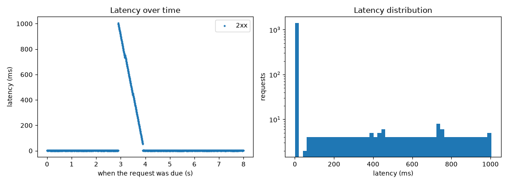

# 07 Three experiments on Switchyard

> Module: Python runtime and honest measurement · Time: ~4 h · Builds on: 06; Core 01 lessons 13 and 16 (backpressure, workers)

## The problem

`kload` can now put honest load on Switchyard. A single run still tells you little: "p99 1.95 ms" is neither good nor bad until you know what it is normally, what a fault does to it, and where the limits are, both Switchyard's and `kload`'s. This lesson runs the experiments that answer those questions, and turns each run's raw rows into a table and a plot you can reason from.

## The mental model

~~~text
  experiment 1  baseline         GET /health, nothing wrong       → what "normal" looks like
  experiment 2  freeze           SIGSTOP Switchyard for 1 s,      → what a stall does, and
                                 measured open and closed            what a closed loop hides
  experiment 3  saturation       POST /jobs faster than 2 workers → where backpressure starts,
                                 can run them                        and what it looks like
  then          the tool itself  raise the rate until kload        → whose limit you're seeing
                                 is the bottleneck
~~~

- A **baseline** is the same measurement with nothing wrong. Every other number is read against it.
- A **per-second table** groups requests by the second they were due. Percentiles over a whole run blur a one-second event into the rest; a per-second table shows when it started and how long it lasted.
- A **latency-over-time plot** shows each request as a dot: a freeze is a slanted line of dots, each one due a little later and so waiting a little less.

## The pattern

**One change at a time, against a baseline, with the raw data kept.** And before blaming the system, check the tool.

## Build it

### Step 1: Tables and plots

Add pandas, for tables, and matplotlib, for plots:

~~~bash
uv add 'pandas>=3.0' 'matplotlib>=3.10'
~~~

<!-- run: uv add 'pandas>=3.0' 'matplotlib>=3.10' -->

Create `src/kload/analyze.py`:

<!-- file: src/kload/analyze.py -->
~~~python
"""Turn raw results into a report, a per-second table and plots."""

from pathlib import Path

import pandas as pd

from kload.stats import percentile

def load_frame(path: Path) -> pd.DataFrame:
    df = pd.read_csv(path, keep_default_na=False)
    df["latency_ms"] = df["latency_s"] * 1000
    df["lag_ms"] = (df["sent_s"] - df["scheduled_s"]) * 1000
    df["ok"] = df["status"].between(200, 299)
    return df

def report(df: pd.DataFrame) -> dict[str, float]:
    """Headline numbers. Latency percentiles cover 2xx responses only."""
    if df.empty:
        raise ValueError("no results to report")
    ok = df.loc[df["ok"], "latency_ms"].tolist()
    span = df["scheduled_s"].max() - df["scheduled_s"].min()

    def pct(p: float) -> float:
        return round(percentile(ok, p), 2) if ok else float("nan")

    return {
        "requests": len(df),
        "error_rate": round(1 - df["ok"].mean(), 4),
        "rate_per_s": round(len(df) / span, 1) if span > 0 else float(len(df)),
        "p50_ms": pct(50),
        "p99_ms": pct(99),
        "max_ms": round(max(ok), 2) if ok else float("nan"),
        "lag_p99_ms": round(percentile(df["lag_ms"].tolist(), 99), 2),
    }

def per_second(df: pd.DataFrame) -> pd.DataFrame:
    """Requests, errors, and p50 and p99 latency for each second of the run."""
    second = df["scheduled_s"].astype(int).rename("second")
    grouped = df.groupby(second)

    def pct(p: float):
        return lambda s: round(percentile(s.tolist(), p), 1)

    return pd.DataFrame(
        {
            "requests": grouped.size(),
            "errors": grouped["ok"].apply(lambda ok: int((~ok).sum())),
            "p50_ms": grouped["latency_ms"].apply(pct(50)),
            "p99_ms": grouped["latency_ms"].apply(pct(99)),
        }
    )

def plot(df: pd.DataFrame, path: Path) -> None:
    """Latency over time (to spot stalls), and its distribution (to see the tail)."""
    import matplotlib

    matplotlib.use("Agg")  # draw to a file; no window needed
    import matplotlib.pyplot as plt

    fig, (timeline, histogram) = plt.subplots(1, 2, figsize=(11, 4))
    ok, failed = df[df["ok"]], df[~df["ok"]]
    timeline.scatter(ok["scheduled_s"], ok["latency_ms"], s=4, label="2xx")
    if not failed.empty:
        timeline.scatter(failed["scheduled_s"], failed["latency_ms"], s=4, c="red", label="other")
    timeline.set(xlabel="when the request was due (s)", ylabel="latency (ms)")
    timeline.set_title("Latency over time")
    timeline.legend()
    histogram.hist(df["latency_ms"], bins=50)
    histogram.set(xlabel="latency (ms)", ylabel="requests", yscale="log")
    histogram.set_title("Latency distribution")
    fig.tight_layout()
    fig.savefig(path, dpi=100)
    plt.close(fig)
~~~

- `pd.read_csv` loads the CSV into a **DataFrame**: a table whose columns are arrays. `df["latency_s"] * 1000` multiplies a whole column at once, with no Python loop. `keep_default_na=False` keeps an empty `error` as `""` instead of turning it into "not a number".
- `df.groupby(second)` splits the rows by the second each request was due, and `.size()` and `.apply(...)` compute one value per group.
- `plot` imports matplotlib inside the function, so `kload load` never pays for importing it; `matplotlib.use("Agg")` draws to a file, with no window.

Create `tests/test_analyze.py`:

<!-- file: tests/test_analyze.py -->
~~~python
from kload.analyze import load_frame, per_second, plot, report
from kload.load import Result
from kload.results import write_results

def sample(tmp_path):
    results = [Result(i, i * 0.01, i * 0.01, 0.005, 200) for i in range(150)]
    results[120] = Result(120, 1.2, 1.2, 0.0, 0, "ConnectError")
    results[130] = Result(130, 1.3, 1.302, 0.9, 200)
    path = tmp_path / "run.csv"
    write_results(results, path, {"rate": 100})
    return load_frame(path)

def test_report(tmp_path):
    numbers = report(sample(tmp_path))
    assert numbers["requests"] == 150
    assert numbers["error_rate"] == round(1 / 150, 4)
    assert numbers["p50_ms"] == 5.0
    assert numbers["max_ms"] == 900.0
    assert numbers["lag_p99_ms"] == 0.0

def test_per_second(tmp_path):
    table = per_second(sample(tmp_path))
    assert table["requests"].tolist() == [100, 50]
    assert table["errors"].tolist() == [0, 1]
    assert table["p99_ms"].tolist() == [5.0, 900.0]

def test_plot_writes_a_png(tmp_path):
    out = tmp_path / "plot.png"
    plot(sample(tmp_path), out)
    assert out.read_bytes()[:8] == b"\x89PNG\r\n\x1a\n"
~~~

And give it a command. In `src/kload/cli.py`, add `json` to the imports:

<!-- edit: src/kload/cli.py -->
~~~python
import asyncio
import sys
~~~

to:

~~~python
import asyncio
import json
import sys
~~~

add the command before `build_parser`:

<!-- edit: src/kload/cli.py -->
~~~python
def build_parser() -> argparse.ArgumentParser:
~~~

to:

~~~python
def cmd_analyze(args: argparse.Namespace) -> int:
    from kload.analyze import load_frame, per_second, plot, report

    df = load_frame(Path(args.file))
    print(json.dumps(report(df), indent=2))
    print(per_second(df).to_string())
    if args.plot:
        plot(df, Path(args.plot))
        print(f"wrote {args.plot}")
    return 0

def build_parser() -> argparse.ArgumentParser:
~~~

and its subcommand:

<!-- edit: src/kload/cli.py -->
~~~python
    p.set_defaults(handler=cmd_load)
    return parser
~~~

to:

~~~python
    p.set_defaults(handler=cmd_load)

    p = sub.add_parser("analyze", help="report on a results file, and plot it")
    p.add_argument("file")
    p.add_argument("--plot", help="write a PNG here")
    p.set_defaults(handler=cmd_analyze)
    return parser
~~~

<!-- run: uv run ruff format --check . && uv run ruff check . && uv run pytest -q -->

### Step 2: Experiment 1, the baseline

Build Switchyard once, so the experiments can find it by name and freeze it. Core 01 lesson 15 put `/bin/` in its `.gitignore`:

~~~bash
cd ~/blueprint/switchyard && go build -o bin/switchyard ./cmd/switchyard && ./bin/switchyard
~~~

In the `kload` folder:

~~~bash
uv run kload load --rate 200 --duration 10 --out results/base.csv
~~~

~~~text
open loop: 2000 requests at 200/s over 10 s
answers: 200 x2000
latency (2xx): p50 1.19 ms, p99 2.00 ms, max 11.79 ms
kload itself: send lag p99 1.27 ms, max 2.63 ms; CPU 0.67 s in 10.00 s (7%)
wrote results/base.csv and results/base.json
~~~

Write those numbers down: p50, p99, max, and `kload`'s own lag and CPU. That's "normal" for this machine, this build and this rate. **A measurement means nothing without a baseline to compare it with.**

### Step 3: Experiment 2, freeze the server

`kill -STOP` freezes a process completely, the way a long garbage-collection pause or a paused virtual machine would; `kill -CONT` resumes it. Run the load while freezing Switchyard for 1 second, 3 seconds in, first open, then closed:

~~~bash
for mode in open closed; do
  (sleep 3; kill -STOP $(pgrep -x switchyard); sleep 1; kill -CONT $(pgrep -x switchyard)) &
  freezer=$!
  uv run kload load --rate 200 --duration 8 --mode $mode --out results/freeze-$mode.csv
  wait $freezer
done
~~~

~~~text
open loop: 1600 requests at 200/s over 8 s
answers: 200 x1600
latency (2xx): p50 1.29 ms, p99 926.36 ms, max 1004.41 ms
kload itself: send lag p99 1.24 ms, max 2.53 ms; CPU 0.64 s in 8.01 s (8%)
wrote results/freeze-open.csv and results/freeze-open.json
closed loop: 1600 requests at up to 200/s, one at a time, in 8.00 s (latency timed from sending: a stall is hidden)
answers: 200 x1600
latency (2xx): p50 0.48 ms, p99 0.81 ms, max 1002.95 ms
kload itself: send lag p99 924.95 ms, max 999.09 ms; CPU 0.52 s in 8.00 s (7%)
wrote results/freeze-closed.csv and results/freeze-closed.json
~~~

`wait $freezer` waits for the freezing job only: a bare `wait` would also wait for any Switchyard you started with `&` in this shell, for ever.

**The same freeze, measured two ways.** The open loop's p99 is 926 ms; the closed loop's is 0.81 ms, a perfectly healthy service. The closed loop sent one request into the freeze, waited a second for it, then carried on: one slow sample in 1,600. But look at its own send lag: p99 925 ms. Those are the requests it should have sent during the freeze and didn't. A closed loop's missing latency doesn't vanish; it moves into its lateness, which most tools never report.

Now the per-second table and the plot:

~~~bash
uv run kload analyze results/freeze-open.csv --plot results/freeze-open.png
~~~

~~~text
{
  "requests": 1600,
  "error_rate": 0.0,
  "rate_per_s": 200.1,
  "p50_ms": 1.29,
  "p99_ms": 926.36,
  "max_ms": 1004.41,
  "lag_p99_ms": 1.24
}
        requests  errors  p50_ms  p99_ms
second                                  
0            200       0     1.2     1.8
1            200       0     1.2     1.9
2            200       0     1.3   995.2
3            200       0   442.0   892.4
4            200       0     1.2     1.9
5            200       0     1.2     2.0
6            200       0     1.2     2.0
7            200       0     1.3     2.3
wrote results/freeze-open.png
~~~

The freeze is the slanted line on the left plot: the request due as the freeze began waited the full second, and each one after it waited a little less, because it was due a little later. In the table it spans two seconds (it started partway through one second and ended partway through the next), and the p50 for the second it mostly filled jumped to hundreds of milliseconds. The histogram on the right, drawn with a logarithmic count, shows two populations: the normal requests near 1 ms, and the frozen ones spread up to a second.

### Step 4: Experiment 3, saturation

In core 01 lesson 13, Switchyard's queue refuses new jobs with `503` when it's full. Stop Switchyard (Ctrl-C in its terminal), and start it again with a small queue and two workers, each running one job at a time:

~~~bash
cd ~/blueprint/switchyard && go build -o bin/worker ./cmd/worker
QUEUE_CAPACITY=50 ./bin/switchyard &
WORKER_NAME=a ./bin/worker & WORKER_NAME=b ./bin/worker &
~~~

Every job takes 50 ms, so two workers finish at most 40 a second. Send jobs at 20 a second, then at 100:

~~~bash
for r in 20 100; do
  uv run kload load --method POST --path /jobs --body '{"description":"kload","duration_ms":50}' \
    --rate $r --duration 10 --out results/jobs$r.csv
done
uv run kload analyze results/jobs100.csv | tail -11
~~~

~~~text
open loop: 200 requests at 20/s over 10 s
answers: 201 x200
latency (2xx): p50 1.72 ms, p99 3.08 ms, max 11.36 ms
kload itself: send lag p99 1.56 ms, max 1.77 ms; CPU 0.14 s in 9.95 s (1%)
wrote results/jobs20.csv and results/jobs20.json
open loop: 1000 requests at 100/s over 10 s
answers: 201 x437, 503 x563
latency (2xx): p50 1.83 ms, p99 3.14 ms, max 3.21 ms
kload itself: send lag p99 2.38 ms, max 5.56 ms; CPU 0.45 s in 9.99 s (5%)
wrote results/jobs100.csv and results/jobs100.json
second                                  
0            100      11     1.7     2.8
1            100      61     1.8     3.1
2            100      62     1.9     3.4
3            100      61     1.9     3.1
4            100      61     1.8     3.1
5            100      62     1.9     3.2
6            100      61     1.8     3.3
7            100      61     1.8     3.0
8            100      62     1.9     3.1
9            100      61     1.7     3.2
~~~

At 20 a second, every job was accepted. At 100, Switchyard accepted 437 and refused the other 563 with `503`: in the first second, while the 50-slot queue filled, only a few were refused; after that, about 60 a second, the rate it received minus the rate the workers drained. Notice what didn't happen: the p99 of the accepted jobs stayed near 3 ms, and the refusals were just as quick. `POST /jobs` only puts a job in the queue, and a full queue says no at once instead of making the client wait. That's backpressure working: the error rate tells you the service is saturated, not the latency.

### Step 5: Is the tool the bottleneck?

Stop the workers and Switchyard, and start Switchyard again with its normal settings. Then raise the rate on `GET /health`, and split the highest rate across two `kload` processes:

~~~bash
pkill -x worker; pkill -x switchyard
cd ~/blueprint/switchyard && ./bin/switchyard &
cd ~/blueprint/kload
uv run kload load --rate 2000 --duration 5 --out results/h2000.csv
uv run kload load --rate 4000 --duration 5 --out results/h4000.csv
uv run kload load --rate 2000 --duration 5 --out results/split1.csv > /tmp/split1.txt &
first=$!
uv run kload load --rate 2000 --duration 5 --out results/split2.csv > /tmp/split2.txt
wait $first
cat /tmp/split1.txt /tmp/split2.txt
~~~

~~~text
open loop: 10000 requests at 2000/s over 5 s
answers: 200 x10000
latency (2xx): p50 0.86 ms, p99 1.71 ms, max 7.58 ms
kload itself: send lag p99 1.16 ms, max 7.28 ms; CPU 1.72 s in 5.01 s (34%)
wrote results/h2000.csv and results/h2000.json
kload used 78% of a CPU: close to its limit, so replies may have waited for it to read them. Lower the rate, or split it across processes.
open loop: 20000 requests at 4000/s over 5 s
answers: 200 x20000
latency (2xx): p50 0.57 ms, p99 1.56 ms, max 16.95 ms
kload itself: send lag p99 0.86 ms, max 16.32 ms; CPU 3.94 s in 5.03 s (78%)
wrote results/h4000.csv and results/h4000.json
open loop: 10000 requests at 2000/s over 5 s
answers: 200 x10000
latency (2xx): p50 0.67 ms, p99 1.93 ms, max 13.34 ms
kload itself: send lag p99 1.18 ms, max 8.67 ms; CPU 2.06 s in 5.02 s (41%)
wrote results/split1.csv and results/split1.json
open loop: 10000 requests at 2000/s over 5 s
answers: 200 x10000
latency (2xx): p50 0.68 ms, p99 1.78 ms, max 14.50 ms
kload itself: send lag p99 1.18 ms, max 9.28 ms; CPU 2.17 s in 5.02 s (43%)
wrote results/split2.csv and results/split2.json
~~~

At 4,000 a second from one `kload`, the send lag stayed under a millisecond, and this time the p99, 1.56 ms, was no worse than at 2,000. But `kload` used 78% of a CPU and warned you, and that close to its limit its numbers stop being repeatable. In this module's first capture the same command gave a p99 of 5.61 ms, and on the author's laptop 20.6 ms, while two `kload` processes at 2,000 a second each, the **same** 4,000 a second on Switchyard, saw 1.8 ms each. Switchyard was fine all along. The slow tails were replies waiting for one busy Python thread to get round to reading them.

So check the tool twice: its send lag (did it send on time?) and its CPU (could it read the replies on time?). When either is high, spread the load over processes, use a generator written in a compiled language, or lower the rate.

<!-- run: uv run ruff format --check . && uv run ruff check . && uv run pytest -q -->

## A question for core 06

During the freeze, the open loop kept sending: every request due in that second went out on its own connection to a process that wasn't running, and every one was answered once Switchyard resumed. Who completed those TCP handshakes while Switchyard was stopped, and what would have happened if they couldn't? Core 06 captures the packets to find out.

## Break it

**Report the mean.** In `report`, add `"mean_ms": round(df["latency_ms"].mean(), 2)` and run `uv run kload analyze results/freeze-open.csv | head -10`:

~~~text
{
  "requests": 1600,
  "error_rate": 0.0,
  "rate_per_s": 200.1,
  "p50_ms": 1.29,
  "p99_ms": 926.36,
  "max_ms": 1004.41,
  "mean_ms": 68.2,
  "lag_p99_ms": 1.24
}
~~~

A mean of 68.2 ms: a latency almost no request had. Most were about 1 ms, the frozen ones hundreds. Remove it.

## Check it

~~~bash
uv run kload analyze results/base.csv
~~~

Then, from memory: what did the closed loop report for the freeze, and where did the missing time go? What told you Switchyard was saturated in experiment 3, if not the latency? How did you prove the 4,000-a-second tail was `kload`'s and not Switchyard's?

These experiments show what each kind of trouble looks like, once, on your machine. One run can't say whether a difference between two runs is real, or whether you'd see it again: lesson 08 does.

## If it goes wrong

| Symptom | Cause | Fix |
|---|---|---|
| `kill: usage` or `pgrep` finds nothing | Switchyard started with `go run`, or isn't running | Build it to `bin/switchyard` and run that |
| The freeze doesn't show | The `sleep 3` fired before `kload` started, or after it finished | Keep `--duration 8`; check the per-second table for the jump |
| Every `POST /jobs` gets `503` | No workers running, so nothing drains the queue | Start the two workers |
| No `503`s at 100 a second | More workers, or a bigger queue, than the lesson's | `QUEUE_CAPACITY=50` and exactly two workers |
| `ModuleNotFoundError: pandas` | `uv add` not run in this project | `uv add 'pandas>=3.0' 'matplotlib>=3.10'` |
