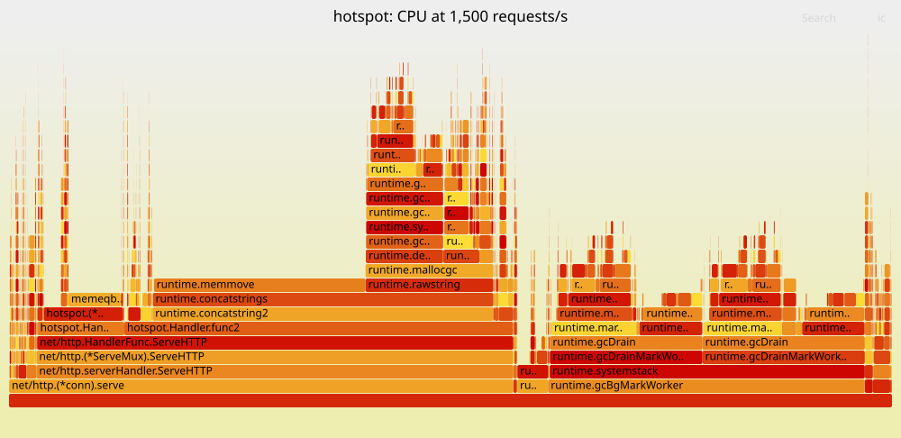
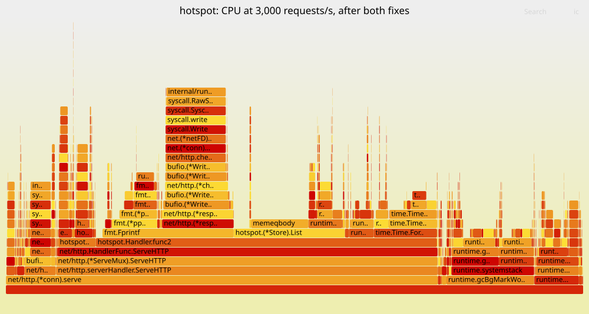

# 03 Computing: CPU profiles and flame graphs

## What this step teaches

- CPU profiles, and how to read a **flame graph**.
- Profile, fix the top item, profile again.
- That the top item is often not what you expected.

The service now falls over at high rates, so check USE again. At 1,500/s for 30 seconds:

~~~text
sent 45000 in 40.0s (1125/s), errors 11429
latency p50 190.15ms  p90 5.71349s  p99 9.6286s  max 10.0021s
~~~

It holds at first, then collapses as jobs pile up: **11,000 errors**. This time the CPUs are busy, so it's the classic case for a CPU profile. A CPU profiler interrupts the program about 100 times a second and records the stack. Functions that show up in many samples are where the time goes.

~~~bash
./bin/load -rate 1500 -for 30s &
sleep 18
curl -s -o cpu.pb.gz 'http://127.0.0.1:6060/debug/pprof/profile?seconds=10'
go tool pprof -top -nodecount=10 bin/hotspot cpu.pb.gz
~~~

~~~text
Type: cpu
Duration: 10s, Total samples = 85.22s (852.05%)
      flat  flat%   sum%        cum   cum%
    20.73s 24.33% 24.33%     20.73s 24.33%  runtime.memmove
     5.55s  6.51% 30.84%      5.55s  6.51%  memeqbody
     5.07s  5.95% 36.79%      7.48s  8.78%  runtime.(*unwinder).resolveInternal
     4.52s  5.30% 42.09%      4.52s  5.30%  runtime.spanClass.sizeclass (inline)
     4.21s  4.94% 47.03%     13.26s 15.56%  runtime.scanObjectsSmall
     3.12s  3.66% 50.69%      8.78s 10.30%  runtime.tryDeferToSpanScan
     3.01s  3.53% 54.22%      3.01s  3.53%  internal/runtime/syscall/linux.Syscall6
     2.83s  3.32% 57.55%      2.83s  3.32%  runtime.futex
     2.52s  2.96% 60.50%      2.80s  3.29%  runtime.findObject
     2.22s  2.61% 63.11%      4.90s  5.75%  runtime.scanblock
~~~

`Total samples = 85.22s` in a 10-second profile: **8.5 cores busy**. From reading the code, you'd probably have bet on `Create`'s linear scan, the obvious O(*n*²): it checks every stored job on every create. **That bet is wrong.** `Create` is 9% of the time, and it isn't in this list at all. The biggest item is `runtime.memmove`: copying memory. The next several are the garbage collector (`scanObjectsSmall`, `tryDeferToSpanScan`, `findObject`).

## Flame graphs

A list of functions loses the call paths. A **flame graph** shows them all at once:

- each box is a function, and the box above it is what it called;
- **width** is the share of samples, so wide boxes are where time goes;
- left to right is alphabetical, **not** time.

Get Brendan Gregg's scripts once, then turn a profile into an SVG:

~~~bash
git clone --depth 1 https://github.com/brendangregg/FlameGraph ~/FlameGraph
go tool pprof -raw bin/hotspot cpu.pb.gz | perl ~/FlameGraph/stackcollapse-go.pl > cpu.folded
perl ~/FlameGraph/flamegraph.pl --title "hotspot: CPU at 1,500 requests/s" cpu.folded > flame.svg
~~~

(`go tool pprof -http=:8081 cpu.pb.gz` also opens one in a browser.)

Open the SVG in a browser to zoom and search. Two wide towers: the garbage collector's mark workers, and a tower rising through `hotspot.Handler.func2`, the **list** handler, into `runtime.concatstrings` and `memmove`. In numbers:

~~~bash
go tool pprof -top -cum -nodecount=10 bin/hotspot cpu.pb.gz
~~~

~~~text
      flat  flat%   sum%        cum   cum%
     0.04s 0.047% 0.047%     48.67s 57.11%  net/http.(*conn).serve
     0.01s 0.012% 0.059%     46.02s 54.00%  net/http.(*ServeMux).ServeHTTP
         0     0% 0.059%     46.02s 54.00%  net/http.serverHandler.ServeHTTP
     0.01s 0.012%  0.07%     45.96s 53.93%  net/http.HandlerFunc.ServeHTTP
     0.05s 0.059%  0.13%     44.66s 52.41%  runtime.systemstack
     0.27s  0.32%  0.45%     37.53s 44.04%  hotspot.Handler.func2
     0.03s 0.035%  0.48%     32.94s 38.65%  runtime.concatstring2
     0.11s  0.13%  0.61%     32.92s 38.63%  runtime.concatstrings
         0     0%  0.61%     30.56s 35.86%  runtime.gcBgMarkWorker
     0.01s 0.012%  0.62%     30.40s 35.67%  runtime.gcBgMarkWorker.func2
~~~

The list handler takes **44% of the CPU**, and only 5% of requests are lists. Its loop does `out += ...`. Go strings are immutable, so each `+=` allocates a new string and copies everything so far: O(*m*²) copying for *m* lines, and a mountain of garbage, which is the collector's 36%. A tenant with 5,000 jobs copies about 300 MB to build one 125 KB response. The cost was invisible when jobs were few, which is why it held for the first seconds.

The fix writes each line straight to the response, which buffers it. In `handler.go`:

<!-- edit: handler.go -->
~~~go
		jobs := s.List(r.URL.Query().Get("tenant"))
		out := ""
		for _, j := range jobs {
			out += fmt.Sprintf("%d\t%s\t%s\n", j.ID, j.Key, j.Created.Format("15:04:05.000"))
		}
		w.Header().Set("Content-Type", "text/plain")
		fmt.Fprint(w, out)
~~~

to:

~~~go
		jobs := s.List(r.URL.Query().Get("tenant"))
		w.Header().Set("Content-Type", "text/plain")
		for _, j := range jobs {
			// Write each line straight out: the response writer buffers it.
			fmt.Fprintf(w, "%d\t%s\t%s\n", j.ID, j.Key, j.Created.Format("15:04:05.000"))
		}
~~~

<!-- run: test -z "$(gofmt -l .)" && go vet ./... && go test ./... -->

## Profile again

Never assume a fix worked, and never assume you know what's next. The same run, the same profile:

~~~text
sent 45000 in 30.0s (1499/s), errors 0
latency p50 2.47ms  p90 3.79ms  p99 25.9ms  max 36.26ms
~~~

~~~text
Type: cpu
Duration: 10s, Total samples = 11440ms (114.39%)
      flat  flat%   sum%        cum   cum%
    2120ms 18.53% 18.53%     2120ms 18.53%  memeqbody
    2040ms 17.83% 36.36%     2040ms 17.83%  internal/runtime/syscall/linux.Syscall6
    1620ms 14.16% 50.52%     4240ms 37.06%  hotspot.(*Store).Create
    1580ms 13.81% 64.34%     1580ms 13.81%  runtime.futex
     230ms  2.01% 66.35%      230ms  2.01%  runtime.memmove
     230ms  2.01% 68.36%      310ms  2.71%  runtime.tryDeferToSpanScan
     180ms  1.57% 69.93%      180ms  1.57%  runtime.memclrNoHeapPointers
     160ms  1.40% 71.33%      750ms  6.56%  hotspot.(*Store).List
     140ms  1.22% 72.55%      350ms  3.06%  time.Time.appendFormat
     130ms  1.14% 73.69%      130ms  1.14%  runtime.memequal
~~~

From **8.5 cores to 1.1**, at the same rate, and p99 from 9.6 s to 26 ms: one loop. And now the top of the list is what it first looked like: `memeqbody` (comparing strings) under `Create`. `-list` shows the lines:

~~~text
Total: 11.44s
ROUTINE ======================== hotspot.(*Store).Create in hotspot/store.go
     1.62s      4.24s (flat, cum) 37.06% of Total
         .       40ms     43:	s.mu.Lock()
      10ms       10ms     44:	defer s.mu.Unlock()
     620ms      620ms     45:	for _, j := range s.jobs {
     960ms      3.04s     46:		if j.Tenant == tenant && j.Key == key {
      30ms       40ms     50:	j := Job{ID: s.nextID, Tenant: tenant, Key: key, Payload: payload, Created: time.Now()}
         .       10ms     52:	s.jobs = append(s.jobs, j)
         .      370ms     53:	if err := s.writeAudit(j); err != nil {
         .      110ms     56:	return j, false, nil
~~~

Each create compares against every job stored, under the lock. A map finds the key in one step. In `store.go`:

<!-- edit: store.go -->
~~~go
	jobs   []Job
	nextID int64
~~~

to:

~~~go
	jobs   []Job
	byKey  map[string]int // tenant + "\x00" + key → position in jobs
	nextID int64
~~~

<!-- edit: store.go -->
~~~go
	return &Store{audit: audit, nextID: 1}
~~~

to:

~~~go
	return &Store{audit: audit, nextID: 1, byKey: make(map[string]int)}
~~~

<!-- edit: store.go -->
~~~go
	for _, j := range s.jobs {
		if j.Tenant == tenant && j.Key == key {
			return j, true, nil
		}
	}
	j := Job{ID: s.nextID, Tenant: tenant, Key: key, Payload: payload, Created: time.Now()}
	s.nextID++
	s.jobs = append(s.jobs, j)
~~~

to:

~~~go
	k := tenant + "\x00" + key // \x00 can't appear in either, so keys can't collide
	if i, ok := s.byKey[k]; ok {
		return s.jobs[i], true, nil
	}
	j := Job{ID: s.nextID, Tenant: tenant, Key: key, Payload: payload, Created: time.Now()}
	s.nextID++
	s.byKey[k] = len(s.jobs)
	s.jobs = append(s.jobs, j)
~~~

Why the `\x00`? Plain concatenation makes tenant `ab` with key `c` the same as tenant `a` with key `bc`. The existing test, in which two tenants use one key, still passes.

<!-- run: test -z "$(gofmt -l .)" && go vet ./... && go test ./... -->

~~~text
$ ./bin/load -rate 1500 -for 30s
sent 45000 in 30.0s (1499/s), errors 0
latency p50 2.27ms  p90 3.09ms  p99 6.01ms  max 17.92ms
$ ./bin/load -rate 3000 -for 30s
sent 90000 in 30.1s (2989/s), errors 0
latency p50 2.81ms  p90 12.03ms  p99 69.61ms  max 176.63ms
~~~

3,000 a second now holds. The flame graph has changed shape:

There's no single tower any more; the work is spread out. The new list:

~~~text
Type: cpu
Duration: 10s, Total samples = 28570ms (285.66%)
      flat  flat%   sum%        cum   cum%
    5170ms 18.10% 18.10%     5170ms 18.10%  internal/runtime/syscall/linux.Syscall6
    2840ms  9.94% 28.04%     2840ms  9.94%  memeqbody
    1970ms  6.90% 34.93%     1970ms  6.90%  runtime.futex
    1680ms  5.88% 40.81%     1680ms  5.88%  runtime.memmove
    1270ms  4.45% 45.26%     2420ms  8.47%  runtime.tryDeferToSpanScan
     860ms  3.01% 48.27%      880ms  3.08%  time.appendInt
     820ms  2.87% 51.14%      820ms  2.87%  runtime.spanClass.sizeclass (inline)
     810ms  2.84% 53.97%     3150ms 11.03%  runtime.scanObject
     780ms  2.73% 56.70%     5500ms 19.25%  hotspot.(*Store).List
     710ms  2.49% 59.19%     2430ms  8.51%  time.Time.appendFormat
~~~

The top item is now `Syscall6`, the entry into the kernel, at 18%; step 5 is about that. `memeqbody` is still there at 10%, and `pprof -peek 'memeqbody$'` shows it comes from `Store.List`, scanning all jobs for one tenant's. That's step 7's concern.

**When do you stop?** When you meet the goal. A profile always has a top item. Set the target first ("3,000 a second with p99 under 100 ms"), and stop when you've reached it.

**Explain it:** What do `flat` and `cum` mean? What do a flame graph's width and height show, and what doesn't the left-to-right order show? Why was the obvious suspect the wrong one on the first profile? Why did the list handler's cost rise over time? Why did a change to a 5% endpoint speed up every request? How do you decide when to stop?

**Read.** Brendan Gregg, [*Flame Graphs*](https://www.brendangregg.com/flamegraphs.html). Go, [*Profiling Go Programs*](https://go.dev/blog/pprof).

---
