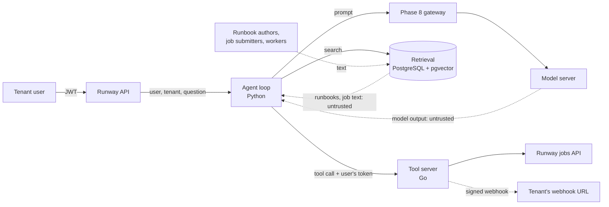

# 01 A threat model for the AI layer

Phase 6 threat-modelled a system that already existed. This time you model one that doesn't exist yet. That's the cheapest moment: a design flaw found on paper costs an afternoon, and the same flaw found in production costs an incident.

Phase 6's method still applies, as Adam Shostak's four questions:

1. **What are we working on?** A diagram, the assets, the actors.
2. **What can go wrong?** Threats, found systematically, not by inspiration.
3. **What are we going to do about it?** A decision for every threat, including "accept it".
4. **Did we do a good job?** Checked against the running system, at the end (Step 14).

Two things are new here. First, **the model is not a component you can trust to follow its code**: its output depends on everything in its context, including text an attacker wrote. Second, there's a list made for exactly this kind of system, the [OWASP Top 10 for LLM Applications](https://genai.owasp.org/llm-top-10/) (2025 edition). Use it the way Phase 6 used STRIDE: as a checklist that stops you missing whole categories, not as a substitute for thinking.

| ID | OWASP name | In one line |
|---|---|---|
| LLM01 | Prompt Injection | Text in the input changes what the model does |
| LLM02 | Sensitive Information Disclosure | The model, or the system around it, reveals data it shouldn't |
| LLM03 | Supply Chain | Models, datasets and tools you didn't build can be malicious |
| LLM04 | Data and Model Poisoning | Bad data changes what the model or retrieval returns |
| LLM05 | Improper Output Handling | Model output is used in SQL, HTML or a shell without checking |
| LLM06 | Excessive Agency | The agent can do more than its task needs |
| LLM07 | System Prompt Leakage | Secrets or rules in the system prompt get revealed |
| LLM08 | Vector and Embedding Weaknesses | Retrieval leaks between users, or can be manipulated |
| LLM09 | Misinformation | Confident, wrong answers that people act on |
| LLM10 | Unbounded Consumption | Requests that burn compute, tokens or money |

## What we're building

The assistant sits behind Switchyard's API, so every request already carries a verified identity and tenant (Phase 6). Steps 3 and 4 build the pieces in this diagram. The dashed lines are **trust boundaries**: places where data crosses from something less trusted to something more trusted, and must be checked.

Read the dashed arrows carefully. Two of them point *into* the agent: the model's output, and the text that retrieval returns. Everything that arrives along them must be treated like a request from the internet, however trusted the component that sent it.

## What to protect, and from whom

The assets, in rough order of damage if lost:

| Asset | Why it matters |
|---|---|
| A tenant's jobs, runbooks and notes | Other tenants and outsiders must never read or change them |
| The ability to act: retry, cancel, notify | An attacker who steers these acts as the user |
| Webhook secrets and tool credentials | With them, an attacker doesn't need the agent at all |
| The token budget and the model's capacity | Burning them is a denial of service, and costs money |
| The audit trail of what the agent did and why | Without it, an incident can't be explained or proven |
| Model weights and the system prompt | Lower value: the weights are public, and the prompt must hold no secrets |

The actors:

| Actor | What they control | What they want |
|---|---|---|
| An honest tenant user | Their own questions | Correct answers and actions, nothing more |
| A malicious tenant user | Their own questions, and data in their own tenant | Another tenant's data; actions they aren't allowed to take; free compute |
| An outsider who can put text into a tenant's data | A job description, an imported runbook, a job's output | To make the agent act or leak on their behalf, without ever logging in |
| A compromised component | One service: the tool server, a worker, a dependency | To widen its access |
| A malicious publisher | A model file, a library, a tool definition | To run code, or steer the agent, from inside |

The third actor is the one this phase is really about. They never authenticate. They only need their text to be *read* by an agent that can act. In Switchyard, a job's description is written by whoever submitted it, and its failure message comes from the work it ran. If either can reach the agent, either can carry instructions.

## What can go wrong

Write the model into your lab as a file. Every later step attacks one or more of its rows by ID, and Step 14 checks them all on the running system.

<!-- file: docs/security/ai-threat-model.md -->
~~~markdown
# Runway operations assistant: threat model

Status: design, before building. Checked against the running system in Step 14.

## What we're building

An agent behind Runway's API. It answers a tenant's questions from that
tenant's runbooks and job history (retrieval), and calls tools to retry or
cancel a job, add a note, or send the tenant's webhook. The model runs on
the Phase 8 server, behind the Phase 8 gateway.

Trust boundaries: the internet to the API; the API to the agent; the
model's output back into the agent; retrieved text into the agent; the
agent to the tool server; the tool server to external URLs.

Rule: model output and retrieved text are untrusted input. No security
decision depends on the model behaving.

## Threats

| ID | Threat | STRIDE | OWASP | Mitigation (planned) | Step |
|---|---|---|---|---|---|
| A1 | A user asks the agent to do something they aren't allowed to do, and it does | Elevation | LLM01, LLM06 | The tool server checks the user's own permissions on every call | 5, 6 |
| A2 | The tool server acts with the agent's privileges instead of the user's (confused deputy) | Elevation | LLM06 | Each call carries the user's identity; the agent has no standing rights | 5 |
| A3 | Instructions hidden in a runbook or job text make the agent send tenant data out | Information disclosure | LLM01, LLM02 | Egress allow-list; side effects carrying untrusted content need approval | 7 |
| A4 | Hidden instructions make the agent retry or cancel jobs nobody asked about | Tampering | LLM01, LLM06 | Actions limited to what the user's request names; approval for changes | 7 |
| A5 | Model output shown as Markdown leaks data through an image URL | Information disclosure | LLM05 | Strip or allow-list links and images in rendered output | 8 |
| A6 | Model output reaches a SQL query or a shell | Tampering | LLM05 | Structured output, validated; parameters, never string building | 8 |
| A7 | Retrieval returns another tenant's runbooks or jobs | Information disclosure | LLM08 | Row-level security on the vector store, tested from the other side | 3, 9 |
| A8 | The shared prompt cache reveals another tenant's prompt through timing | Information disclosure | LLM02 | No cache sharing across tenants | 9 |
| A9 | Prompts, answers or retrieved text with personal data end up in logs | Information disclosure | LLM02 | Phase 6 redaction applied to the agent's telemetry | 9 |
| A10 | A credential placed in the prompt is revealed by asking for it | Information disclosure | LLM02, LLM07 | No credentials in any prompt; canary tokens to detect leaks | 10 |
| A11 | Loops, huge outputs or padded context burn the budget | Denial of service | LLM10 | Per-tenant step, token and time budgets, enforced outside the model | 4, 11 |
| A12 | A model file runs code when it's loaded | Elevation | LLM03 | Safe formats only; verify signatures before loading (Phase 8) | 12 |
| A13 | A tool's description tells the model to misuse other tools | Tampering | LLM03, LLM01 | Tool definitions are reviewed code, signed and pinned | 12 |
| A14 | Poisoned documents make retrieval return wrong or harmful guidance | Tampering | LLM04, LLM09 | Provenance on documents; answers cite their sources | 3, 7 |
| A15 | An action can't be traced to a user, a request and a reason | Repudiation | LLM06 | Every tool call audited with user, tenant, request and arguments | 4, 5 |

## Non-goals

- Whether the model says something offensive. That's content safety, not
  the platform's security, and it's out of scope here.
- An attacker with root on the host, who can read memory and weights.
- Side channels other than the shared prompt cache.

## Did we do a good job?

Step 14 attacks every row on the running system and records the result.
~~~

Two rows deserve a closer look.

**A2, the confused deputy**, is the oldest bug in this table. Norm Hardy named it in 1988: a program with its own privileges is tricked into using them for someone who doesn't have them. An agent with a service account that can cancel *any* job is exactly that program. The fix isn't a better prompt; it's giving the agent no privileges of its own, so every tool call runs as the user who asked.

**A3 and A4** come from the third actor, who never logs in. Notice where their mitigations sit: in the egress allow-list and the approval step, both outside the model. The model may well be fooled. The design has to be safe anyway.

The **Step** column is a promise: each row will be attacked in that step, and it isn't mitigated until the attack fails and stays failing.

**Your turn:** add at least two rows of your own before going on. Walk the diagram arrow by arrow and ask STRIDE's six questions of each one, as in Phase 6. One hint: what happens to a job the agent retries, if that job's description was the injection?

**Done when:** `docs/security/ai-threat-model.md` exists, every row has a mitigation and a step, and you can explain, without notes, why "the model's output is untrusted input" puts the mitigations where they are.

---
