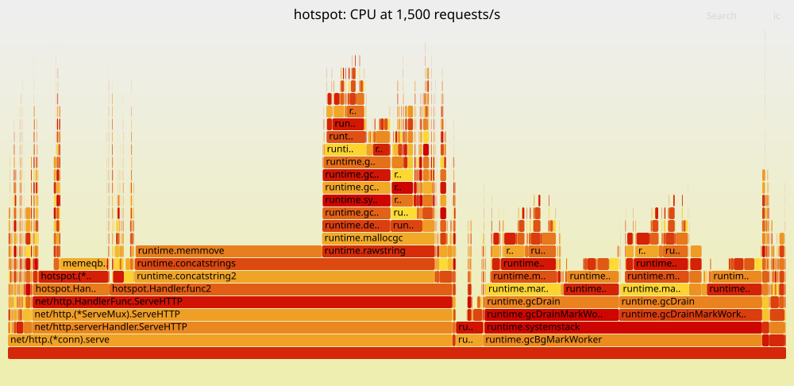
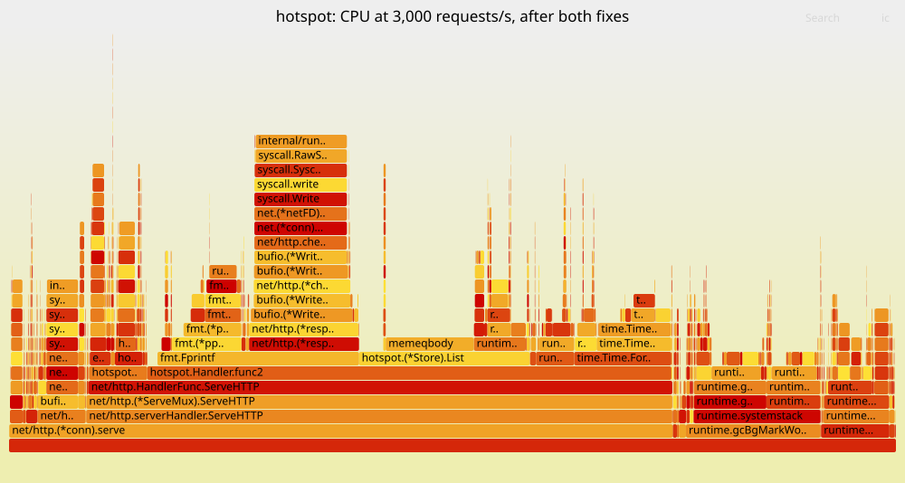

# Performance Bridge teaching: find out why it's slow

Phase 5 taught you to operate a system: SLOs, alerts, a game day. An alert tells you **that** something is wrong. This bridge teaches you to find out **why**, on a live process, with evidence. That's the skill a troubleshooting interview tests ("this box is slow, what do you do?"), and it's most of what senior engineers do during an incident.

**The goal:** `hotspot`, a small Go jobs service with five performance problems planted in it, and the tools to find each one. By the end it handles more than ten times the load it started with, and you can say which fix bought what, with numbers.

**The rule of the bridge:** never guess, and never fix what you haven't measured. Each step follows the evidence, even where it isn't what you expected. Twice while writing this guide, the evidence overturned the plan, and those moments are kept in.

## How this guide works

- Type the code; don't paste it.
- **CI rebuilds the code and runs its tests.** It can't run the live measurements, which need a running service, `perf`, Docker or root. Those outputs were captured by hand on one laptop (an 8-core Ryzen 7 5850U under WSL2). Your numbers will differ. Compare the **ratios and the shape**, not the digits.
- Each step ends with **Explain it** questions and a **Read** list.

## Setup

You need Go 1.26+ and Docker from earlier phases. Make a new repository, called `hotspot`:

<!-- file: go.mod -->
~~~text
module hotspot

go 1.26
~~~

<!-- file: .gitignore -->
~~~text
bin/
audit.log
*.pb.gz
*.data
*.folded
*.svg
~~~

---

## Step 1: A slow service, and the USE method

### What this step teaches

- A service that's slow for a reason you don't yet know.
- A load generator you can trust.
- **The USE method:** for each resource, check **utilisation**, **saturation** and **errors**, before you touch a profiler.

### The service

`hotspot` is a small version of Runway's API: `POST /jobs` stores a job, with an idempotency key per tenant, and `GET /jobs?tenant=` lists a tenant's jobs. Every new job writes an audit line. Before each new job, it checks the tenant with an account service, which here is a 1 ms sleep standing in for a network round trip.

Read it as you type it. Some of what's below is bad on purpose, but don't go looking yet. In real life, nobody tells you the code is broken.

<!-- file: store.go -->
~~~go
// Package hotspot is a small jobs service with performance problems
// planted in it, for the Performance Bridge to find.
package hotspot

import (
	"fmt"
	"io"
	"sync"
	"time"
)

// Job is one submitted job.
type Job struct {
	ID      int64     `json:"id"`
	Tenant  string    `json:"tenant"`
	Key     string    `json:"key"`
	Payload string    `json:"payload"`
	Created time.Time `json:"created"`
}

// Store keeps jobs in memory and writes an audit line for each new one.
type Store struct {
	mu     sync.Mutex
	jobs   []Job
	nextID int64
	audit  io.Writer
}

// NewStore returns an empty store that audits to w.
func NewStore(audit io.Writer) *Store {
	return &Store{audit: audit, nextID: 1}
}

// Create stores a job, unless the tenant already submitted one with the
// same idempotency key; then it returns that one and true.
func (s *Store) Create(tenant, key, payload string) (Job, bool, error) {
	s.mu.Lock()
	defer s.mu.Unlock()

	if err := checkTenant(tenant); err != nil {
		return Job{}, false, err
	}
	for _, j := range s.jobs {
		if j.Tenant == tenant && j.Key == key {
			return j, true, nil
		}
	}
	j := Job{ID: s.nextID, Tenant: tenant, Key: key, Payload: payload, Created: time.Now()}
	s.nextID++
	s.jobs = append(s.jobs, j)
	if err := s.writeAudit(j); err != nil {
		return Job{}, false, err
	}
	return j, false, nil
}

// List returns a tenant's jobs, oldest first.
func (s *Store) List(tenant string) []Job {
	s.mu.Lock()
	defer s.mu.Unlock()
	var out []Job
	for _, j := range s.jobs {
		if j.Tenant == tenant {
			out = append(out, j)
		}
	}
	return out
}

// checkTenant stands in for a call to an account service: it takes about
// a millisecond, like a network round trip.
func checkTenant(tenant string) error {
	if tenant == "" {
		return fmt.Errorf("tenant is required")
	}
	time.Sleep(time.Millisecond)
	return nil
}

func (s *Store) writeAudit(j Job) error {
	fields := []string{
		fmt.Sprintf("id=%d", j.ID),
		" tenant=" + j.Tenant,
		" key=" + j.Key,
		fmt.Sprintf(" bytes=%d", len(j.Payload)),
		" at=" + j.Created.UTC().Format(time.RFC3339Nano),
		"\n",
	}
	for _, f := range fields {
		if _, err := io.WriteString(s.audit, f); err != nil {
			return err
		}
	}
	return nil
}
~~~

<!-- file: handler.go -->
~~~go
package hotspot

import (
	"encoding/json"
	"fmt"
	"net/http"
)

// Handler serves the jobs API.
func Handler(s *Store) http.Handler {
	mux := http.NewServeMux()
	mux.HandleFunc("POST /jobs", func(w http.ResponseWriter, r *http.Request) {
		var in struct{ Tenant, Key, Payload string }
		if err := json.NewDecoder(r.Body).Decode(&in); err != nil {
			http.Error(w, "bad JSON", http.StatusBadRequest)
			return
		}
		j, dup, err := s.Create(in.Tenant, in.Key, in.Payload)
		if err != nil {
			http.Error(w, err.Error(), http.StatusBadRequest)
			return
		}
		status := http.StatusCreated
		if dup {
			status = http.StatusOK
		}
		w.Header().Set("Content-Type", "application/json")
		w.WriteHeader(status)
		json.NewEncoder(w).Encode(j)
	})
	mux.HandleFunc("GET /jobs", func(w http.ResponseWriter, r *http.Request) {
		jobs := s.List(r.URL.Query().Get("tenant"))
		out := ""
		for _, j := range jobs {
			out += fmt.Sprintf("%d\t%s\t%s\n", j.ID, j.Key, j.Created.Format("15:04:05.000"))
		}
		w.Header().Set("Content-Type", "text/plain")
		fmt.Fprint(w, out)
	})
	return mux
}
~~~

The server runs Go's profiler on a separate port, bound to localhost only. Importing `net/http/pprof` registers its handlers on the default mux. **Never expose that port publicly**: profiles reveal your code and data.

<!-- file: cmd/hotspot/main.go -->
~~~go
// Command hotspot serves the jobs API, with Go's profiler on a separate,
// local-only port.
package main

import (
	"flag"
	"log"
	"net/http"
	_ "net/http/pprof" // registers /debug/pprof/ on the default mux
	"os"

	"hotspot"
)

func main() {
	addr := flag.String("addr", "127.0.0.1:8080", "API address")
	debug := flag.String("debug", "127.0.0.1:6060", "profiler address")
	auditPath := flag.String("audit", "audit.log", "audit log file")
	flag.Parse()

	f, err := os.OpenFile(*auditPath, os.O_CREATE|os.O_WRONLY|os.O_APPEND, 0o644)
	if err != nil {
		log.Fatal(err)
	}
	defer f.Close()

	go func() { log.Println(http.ListenAndServe(*debug, nil)) }()
	log.Printf("serving on %s, profiler on %s", *addr, *debug)
	log.Fatal(http.ListenAndServe(*addr, hotspot.Handler(hotspot.NewStore(f))))
}
~~~

<!-- file: store_test.go -->
~~~go
package hotspot

import (
	"io"
	"testing"
)

func TestDuplicateKeyReturnsTheSameJob(t *testing.T) {
	s := NewStore(io.Discard)
	a, dup, err := s.Create("acme", "k1", "x")
	if err != nil || dup {
		t.Fatalf("first create: dup=%v err=%v", dup, err)
	}
	b, dup, _ := s.Create("acme", "k1", "y")
	if !dup || b.ID != a.ID {
		t.Fatalf("second create: dup=%v id=%d, want true and %d", dup, b.ID, a.ID)
	}
	if _, dup, _ := s.Create("globex", "k1", "z"); dup {
		t.Fatal("another tenant's key must not collide")
	}
}

func TestEmptyTenantIsRefused(t *testing.T) {
	if _, _, err := NewStore(io.Discard).Create("", "k", "x"); err == nil {
		t.Fatal("want an error")
	}
}
~~~

### The load generator

To measure a service, you must not fool yourself, so this generator keeps the [Python Bridge](../python-bridge/README.md)'s two rules:

- **Open loop:** requests start on a fixed schedule, whether or not earlier ones have finished, the way real users arrive.
- **Latency runs from the scheduled time,** not from the moment the request was sent. Otherwise, time spent queueing behind a stalled server vanishes from the numbers (coordinated omission).

<!-- file: load/load.go -->
~~~go
// Package load sends requests on a fixed schedule and summarises latency.
package load

import (
	"slices"
	"time"
)

// Result is one request's outcome. Latency is measured from when the
// request was scheduled, not when it was sent, so time spent waiting to be
// sent counts (no coordinated omission).
type Result struct {
	Latency time.Duration
	Status  int // 0 if the request failed before a response
}

// Summary is what a run reports.
type Summary struct {
	Requests, Errors   int
	P50, P90, P99, Max time.Duration
}

// Summarise computes percentiles over successful results (status < 500).
func Summarise(results []Result) Summary {
	s := Summary{Requests: len(results)}
	var lat []time.Duration
	for _, r := range results {
		if r.Status == 0 || r.Status >= 500 {
			s.Errors++
			continue
		}
		lat = append(lat, r.Latency)
	}
	if len(lat) == 0 {
		return s
	}
	slices.Sort(lat)
	s.P50, s.P90, s.P99 = Percentile(lat, 50), Percentile(lat, 90), Percentile(lat, 99)
	s.Max = lat[len(lat)-1]
	return s
}

// Percentile returns the nearest-rank p-th percentile of sorted, which must
// not be empty.
func Percentile(sorted []time.Duration, p float64) time.Duration {
	rank := int(p/100*float64(len(sorted))+0.999999) - 1 // ceil(p/100·n) − 1
	return sorted[max(0, min(rank, len(sorted)-1))]
}
~~~

<!-- file: load/load_test.go -->
~~~go
package load

import (
	"testing"
	"time"
)

func ms(n int) time.Duration { return time.Duration(n) * time.Millisecond }

func TestPercentile(t *testing.T) {
	var lat []time.Duration
	for i := 1; i <= 100; i++ {
		lat = append(lat, ms(i))
	}
	for p, want := range map[float64]time.Duration{50: ms(50), 90: ms(90), 99: ms(99), 100: ms(100)} {
		if got := Percentile(lat, p); got != want {
			t.Errorf("Percentile(1..100 ms, %v) = %v, want %v", p, got, want)
		}
	}
	if got := Percentile([]time.Duration{ms(7)}, 99); got != ms(7) {
		t.Errorf("one value: got %v", got)
	}
}

func TestSummariseCountsErrorsApart(t *testing.T) {
	s := Summarise([]Result{{ms(1), 201}, {ms(2), 200}, {ms(900), 0}, {ms(5), 503}})
	if s.Requests != 4 || s.Errors != 2 || s.Max != ms(2) {
		t.Errorf("Summarise = %+v; want 4 requests, 2 errors, max 2ms", s)
	}
}
~~~

<!-- file: cmd/load/main.go -->
~~~go
// Command load sends jobs to hotspot at a fixed rate and prints latency
// percentiles, measured from each request's scheduled time.
package main

import (
	"bytes"
	"encoding/json"
	"flag"
	"fmt"
	"io"
	"log"
	"math/rand/v2"
	"net/http"
	"sync"
	"time"

	"hotspot/load"
)

func main() {
	url := flag.String("url", "http://127.0.0.1:8080", "hotspot's address")
	rate := flag.Int("rate", 500, "requests a second")
	dur := flag.Duration("for", 10*time.Second, "how long to send")
	keys := flag.Int("keys", 1_000_000, "distinct idempotency keys per tenant (fewer means more duplicates)")
	lists := flag.Float64("lists", 0.05, "fraction of requests that list a tenant's jobs")
	flag.Parse()

	client := &http.Client{
		Timeout:   10 * time.Second,
		Transport: &http.Transport{MaxIdleConnsPerHost: 1024},
	}
	rng := rand.New(rand.NewPCG(1, 2)) // the same requests every run
	n := int(float64(*rate) * dur.Seconds())
	interval := time.Second / time.Duration(*rate)
	results := make([]load.Result, n)

	var wg sync.WaitGroup
	start := time.Now()
	for i := range n {
		scheduled := start.Add(time.Duration(i) * interval)
		time.Sleep(time.Until(scheduled))
		tenant := fmt.Sprintf("t%d", rng.IntN(10))
		var req *http.Request
		if rng.Float64() < *lists {
			req, _ = http.NewRequest("GET", *url+"/jobs?tenant="+tenant, nil)
		} else {
			body, _ := json.Marshal(map[string]string{
				"tenant": tenant, "key": fmt.Sprintf("k%d", rng.IntN(*keys)), "payload": "x",
			})
			req, _ = http.NewRequest("POST", *url+"/jobs", bytes.NewReader(body))
		}
		wg.Add(1)
		go func() {
			defer wg.Done()
			resp, err := client.Do(req)
			if err != nil {
				results[i] = load.Result{Latency: time.Since(scheduled)}
				return
			}
			io.Copy(io.Discard, resp.Body)
			resp.Body.Close()
			results[i] = load.Result{Latency: time.Since(scheduled), Status: resp.StatusCode}
		}()
	}
	wg.Wait()
	s := load.Summarise(results)
	elapsed := time.Since(start)
	log.SetFlags(0)
	log.Printf("sent %d in %.1fs (%.0f/s), errors %d", s.Requests, elapsed.Seconds(), float64(s.Requests)/elapsed.Seconds(), s.Errors)
	log.Printf("latency p50 %v  p90 %v  p99 %v  max %v",
		s.P50.Round(10*time.Microsecond), s.P90.Round(10*time.Microsecond),
		s.P99.Round(10*time.Microsecond), s.Max.Round(10*time.Microsecond))
}
~~~

Build it and run the tests:

<!-- run: test -z "$(gofmt -l .)" && go vet ./... && go test ./... && go build -o bin/ ./cmd/... -->

~~~bash
go vet ./... && go test ./...
go build -o bin/ ./cmd/...
~~~

### Run it

In one terminal, start the service:

~~~bash
./bin/hotspot
~~~

In another, load it at rising rates:

~~~bash
./bin/load -rate 200 -for 10s
./bin/load -rate 500 -for 10s
./bin/load -rate 800 -for 10s
~~~

~~~text
$ ./bin/load -rate 200 -for 10s
sent 2000 in 10.0s (200/s), errors 0
latency p50 2.31ms  p90 2.86ms  p99 3.21ms  max 15.89ms
$ ./bin/load -rate 500 -for 10s
sent 5000 in 10.0s (500/s), errors 0
latency p50 2.15ms  p90 2.79ms  p99 3.16ms  max 8.65ms
$ ./bin/load -rate 800 -for 10s
sent 8000 in 11.2s (717/s), errors 0
latency p50 563.56ms  p90 1.10872s  p99 1.1524s  max 1.15803s
~~~

Fine at 500 requests a second, with a p99 of 3 ms. At 800, a p50 of half a second, and the generator couldn't even finish on time. Somewhere between them is a **knee**: the point where queues start to grow without bound.

### USE, before any profiler

Why? The tempting move is to open the code. Don't. First ask which **resource** is the limit. Brendan Gregg's USE method goes through each resource:

| Resource | Utilisation (how busy?) | Saturation (how much is queued?) | Errors |
|---|---|---|---|
| CPU | `top`, `vmstat`'s `us` and `sy` | `vmstat`'s `r` column; load average | |
| Memory | `free` | swapping (`si`, `so`) | OOM kills in `dmesg` |
| Disk | `iostat` | queue length | `dmesg` |
| Network | `ss`, `ip -s link` | retransmits | drops |

Keep the load running at 800/s, and in a third terminal look:

~~~bash
vmstat 1 5
~~~

~~~text
procs -----------memory---------- ---swap-- -----io---- -system-- -------cpu-------
 r  b   swpd   free   buff  cache   si   so    bi    bo   in   cs us sy id wa st gu
 0  0 229968 5580148  86840 1045928  353  381 16815  2637 14813   22 12  8 79  1  0  0
 1  0 229968 5573332  86840 1045972    0    0     0     0 22661 38339  3  4 93  0  0  0
 1  0 229968 5568108  86848 1045972    0    0     0     0 21319 35838  3  4 93  0  0  0
 0  0 229968 5563508  86848 1046036    0    0     0     0 25511 43807  6  4 90  0  0  0
 2  0 229968 5560860  86848 1046036    0    0     0    44 24225 41580  4  4 91  0  0  0
~~~

Ignore the first line, which is an average since boot. Then:

- `id` is **about 92%**: the machine is nearly idle.
- `r`, the run queue, is 0–2 on a 16-CPU machine: nothing is waiting for a CPU.
- `wa` is 0: nothing is waiting for a disk.
- `si` and `so` are 0: no swapping.

And the process itself:

~~~bash
top -b -n 1 -p $(pgrep -x hotspot) | tail -2
grep -E 'Threads|ctxt_switches' /proc/$(pgrep -x hotspot)/status
~~~

~~~text
    PID USER      PR  NI    VIRT    RES    SHR S  %CPU  %MEM     TIME+ COMMAND
1448896 techiee+  20   0 2747756  52348   7516 S  70.0   0.7   0:17.45 hotspot
Threads:	21
voluntary_ctxt_switches:	11107
nonvoluntary_ctxt_switches:	11
~~~

Read that carefully. The process uses 70% of **one** core out of 16. And **voluntary** context switches outnumber involuntary ones 11,107 to 11. A voluntary switch means a thread gave up the CPU because it had nothing to do: it went to sleep waiting for something. An involuntary one means the scheduler pushed it off.

**So nothing is saturated, and yet requests wait for a second.** The service isn't computing; it's **waiting**. When no resource is full but throughput has hit a ceiling, the limit is usually inside the program: something that only one thing can do at a time. That rules out most guesses, and it tells you the next tool. A CPU profile would be useless here, because it only sees time spent running.

**Explain it:** Why is the first line of `vmstat` different from the rest? What's the difference between utilisation and saturation? What does a mostly idle machine with a latency problem tell you? Why did the generator take 11.2 seconds to send 10 seconds' worth of requests? Which guess would you have made before seeing `vmstat`?

**Read.** Brendan Gregg, [*The USE Method*](https://www.brendangregg.com/usemethod.html), and [*Linux Performance Analysis in 60,000 Milliseconds*](https://netflixtechblog.com/linux-performance-analysis-in-60-000-milliseconds-accc10403c55).

---

## Step 2: Waiting: mutex and block profiles

### What this step teaches

- Go's two profiles for time spent **not** running.
- Why a lock's **critical section** should never contain slow work.
- Fixing the top item, then checking the knee moved.

Go can record how long goroutines wait: the **mutex profile** (contended locks, charged to whoever held them) and the **block profile** (time blocked on locks and channels, charged to the waiter). They're off by default, because they cost a little. Add a flag.

In `cmd/hotspot/main.go`, add the import:

<!-- edit: cmd/hotspot/main.go -->
~~~go
	_ "net/http/pprof" // registers /debug/pprof/ on the default mux
	"os"
~~~

to:

~~~go
	_ "net/http/pprof" // registers /debug/pprof/ on the default mux
	"os"
	"runtime"
~~~

and the flag:

<!-- edit: cmd/hotspot/main.go -->
~~~go
	auditPath := flag.String("audit", "audit.log", "audit log file")
	flag.Parse()
~~~

to:

~~~go
	auditPath := flag.String("audit", "audit.log", "audit log file")
	waits := flag.Bool("profile-waits", false, "record mutex and blocking profiles (costs a little)")
	flag.Parse()

	if *waits {
		runtime.SetMutexProfileFraction(1) // record every contended lock
		runtime.SetBlockProfileRate(1)     // record every blocking event, in nanoseconds
	}
~~~

Rate 1 records everything, which is right for a short investigation and too expensive to leave on in production.

### Run it

~~~bash
go build -o bin/ ./cmd/...
./bin/hotspot -profile-waits
~~~

Load it at 800/s, and five seconds in, fetch the profiles:

~~~bash
./bin/load -rate 800 -for 20s &
sleep 5
curl -s -o block.pb.gz http://127.0.0.1:6060/debug/pprof/block
curl -s -o mutex.pb.gz http://127.0.0.1:6060/debug/pprof/mutex
go tool pprof -top -nodecount=8 block.pb.gz
~~~

~~~text
Type: delay
Showing nodes accounting for 1272.11s, 100% of 1272.12s total
Showing top 8 nodes out of 10
      flat  flat%   sum%        cum   cum%
  1272.11s   100%   100%   1272.11s   100%  sync.(*Mutex).Lock (inline)
         0     0%   100%   1203.72s 94.62%  hotspot.(*Store).Create
         0     0%   100%     68.39s  5.38%  hotspot.(*Store).List
         0     0%   100%   1203.72s 94.62%  hotspot.Handler.func1
         0     0%   100%     68.39s  5.38%  hotspot.Handler.func2
         0     0%   100%   1272.11s   100%  net/http.(*ServeMux).ServeHTTP
         0     0%   100%   1272.12s   100%  net/http.(*Server).Serve.gowrap3
         0     0%   100%   1272.12s   100%  net/http.(*conn).serve
~~~

How to read it:
- **`flat`** is time in that function itself; **`cum`** includes what it called.
- **1,272 seconds** of waiting within seconds of starting isn't a mistake. It's the sum over all goroutines, and hundreds of them were queued at once.

Everything is in `sync.(*Mutex).Lock`, and 95% of it under `Store.Create`. Who was holding the lock? That's the mutex profile, and `-list` shows it line by line:

~~~bash
go tool pprof -list 'Store..Create' mutex.pb.gz
~~~

~~~text
Total: 1208.10s
ROUTINE ======================== hotspot.(*Store).Create in hotspot/store.go
         0   1203.92s (flat, cum) 99.65% of Total
         .          .     36:func (s *Store) Create(tenant, key, payload string) (Job, bool, error) {
         .          .     37:	s.mu.Lock()
         .          .     38:	defer s.mu.Unlock()
         .          .     39:
         .          .     40:	if err := checkTenant(tenant); err != nil {
         .          .     41:		return Job{}, false, err
         .          .     42:	}
         .          .     43:	for _, j := range s.jobs {
         .          .     44:		if j.Tenant == tenant && j.Key == key {
         .          .     45:			return j, true, nil
         .          .     46:		}
         .          .     47:	}
         .          .     48:	j := Job{ID: s.nextID, Tenant: tenant, Key: key, Payload: payload, Created: time.Now()}
         .          .     49:	s.nextID++
         .          .     50:	s.jobs = append(s.jobs, j)
         .     5.29us     51:	if err := s.writeAudit(j); err != nil {
         .          .     52:		return Job{}, false, err
         .          .     53:	}
         .   1203.92s     54:	return j, false, nil
~~~

All of the delay lands on the `return`, where the deferred `Unlock` runs: the lock is held for the **whole** function. And look at what's inside it: `checkTenant`, a 1 ms call to another service. With the lock held across a 1 ms wait, only one request can be in that section at a time, so the service can't exceed 1,000 creates a second, whatever the hardware. That's exactly the ceiling we hit, and why the CPUs sat idle.

### The fix

`checkTenant` touches no shared state, so it doesn't need the lock. In `store.go`:

<!-- edit: store.go -->
~~~go
func (s *Store) Create(tenant, key, payload string) (Job, bool, error) {
	s.mu.Lock()
	defer s.mu.Unlock()

	if err := checkTenant(tenant); err != nil {
		return Job{}, false, err
	}
	for _, j := range s.jobs {
~~~

to:

~~~go
func (s *Store) Create(tenant, key, payload string) (Job, bool, error) {
	// The slow check needs no shared state, so it runs before the lock:
	// a thousand requests can wait on the account service at once.
	if err := checkTenant(tenant); err != nil {
		return Job{}, false, err
	}

	s.mu.Lock()
	defer s.mu.Unlock()
	for _, j := range s.jobs {
~~~

Hold that in place with a test: 100 concurrent creates, each with a 1 ms check, would take at least 100 ms if they ran one at a time. In `store_test.go`:

<!-- edit: store_test.go -->
~~~go
import (
	"io"
	"testing"
)
~~~

to:

~~~go
import (
	"fmt"
	"io"
	"sync"
	"testing"
	"time"
)
~~~

<!-- append: store_test.go -->
~~~go
func TestTheSlowCheckDoesNotHoldTheLock(t *testing.T) {
	s := NewStore(io.Discard)
	start := time.Now()
	var wg sync.WaitGroup
	for i := range 100 {
		wg.Go(func() { s.Create("acme", fmt.Sprintf("k%d", i), "x") })
	}
	wg.Wait()
	if d := time.Since(start); d > 50*time.Millisecond {
		t.Errorf("100 creates took %v: are they running one at a time?", d)
	}
}
~~~

<!-- run: test -z "$(gofmt -l .)" && go vet ./... && go test ./... -->

### Run it

~~~bash
go build -o bin/ ./cmd/...
./bin/hotspot
./bin/load -rate 800 -for 10s
./bin/load -rate 1500 -for 10s
./bin/load -rate 3000 -for 10s
~~~

~~~text
$ ./bin/load -rate 800 -for 10s
sent 8000 in 10.0s (800/s), errors 0
latency p50 2.22ms  p90 3.09ms  p99 6.38ms  max 65.01ms
$ ./bin/load -rate 1500 -for 10s
sent 15000 in 10.1s (1486/s), errors 0
latency p50 2.47ms  p90 5.51ms  p99 26.73ms  max 130.3ms
$ ./bin/load -rate 3000 -for 10s
sent 30000 in 20.0s (1500/s), errors 611
latency p50 1.63026s  p90 6.56083s  p99 9.32578s  max 10.00448s
~~~

800 is now fine: p50 down from over half a second to 2 ms, a change of 250 times from moving three lines. 1,500 holds too. The knee moved up to somewhere below 3,000, where it falls over again, with timeouts counted as errors.

**Break it.** Move `checkTenant` back inside the lock, and run the tests:

~~~text
--- FAIL: TestTheSlowCheckDoesNotHoldTheLock
    store_test.go:41: 100 creates took 115.548256ms: are they running one at a time?
FAIL
~~~

Put it back.

**Explain it:** What's the difference between the mutex profile and the block profile, and who does each charge the time to? Why does 1,272 seconds in a five-second run make sense? Why was throughput capped below 1,000 a second regardless of the hardware? Why couldn't a CPU profile have found this? What else, in a real service, shouldn't be held under a lock?

**Read.** The Go diagnostics guide, [*Diagnostics*](https://go.dev/doc/diagnostics), on the profiles.

---

## Step 3: Computing: CPU profiles and flame graphs

### What this step teaches

- CPU profiles, and how to read a **flame graph**.
- Profile, fix the top item, profile again.
- That the top item is often not what you expected.

The service now falls over at high rates, so check USE again. At 1,500/s for 30 seconds:

~~~text
sent 45000 in 40.0s (1125/s), errors 11429
latency p50 190.15ms  p90 5.71349s  p99 9.6286s  max 10.0021s
~~~

It holds at first, then collapses as jobs pile up: **11,000 errors**. This time the CPUs are busy, so it's the classic case for a CPU profile. A CPU profiler interrupts the program about 100 times a second and records the stack. Functions that show up in many samples are where the time goes.

~~~bash
./bin/load -rate 1500 -for 30s &
sleep 18
curl -s -o cpu.pb.gz 'http://127.0.0.1:6060/debug/pprof/profile?seconds=10'
go tool pprof -top -nodecount=10 bin/hotspot cpu.pb.gz
~~~

~~~text
Type: cpu
Duration: 10s, Total samples = 85.22s (852.05%)
      flat  flat%   sum%        cum   cum%
    20.73s 24.33% 24.33%     20.73s 24.33%  runtime.memmove
     5.55s  6.51% 30.84%      5.55s  6.51%  memeqbody
     5.07s  5.95% 36.79%      7.48s  8.78%  runtime.(*unwinder).resolveInternal
     4.52s  5.30% 42.09%      4.52s  5.30%  runtime.spanClass.sizeclass (inline)
     4.21s  4.94% 47.03%     13.26s 15.56%  runtime.scanObjectsSmall
     3.12s  3.66% 50.69%      8.78s 10.30%  runtime.tryDeferToSpanScan
     3.01s  3.53% 54.22%      3.01s  3.53%  internal/runtime/syscall/linux.Syscall6
     2.83s  3.32% 57.55%      2.83s  3.32%  runtime.futex
     2.52s  2.96% 60.50%      2.80s  3.29%  runtime.findObject
     2.22s  2.61% 63.11%      4.90s  5.75%  runtime.scanblock
~~~

`Total samples = 85.22s` in a 10-second profile: **8.5 cores busy**. From reading the code, you'd probably have bet on `Create`'s linear scan, the obvious O(*n*²): it checks every stored job on every create. **That bet is wrong.** `Create` is 9% of the time, and it isn't in this list at all. The biggest item is `runtime.memmove`: copying memory. The next several are the garbage collector (`scanObjectsSmall`, `tryDeferToSpanScan`, `findObject`).

### Flame graphs

A list of functions loses the call paths. A **flame graph** shows them all at once:

- each box is a function, and the box above it is what it called;
- **width** is the share of samples, so wide boxes are where time goes;
- left to right is alphabetical, **not** time.

Get Brendan Gregg's scripts once, then turn a profile into an SVG:

~~~bash
git clone --depth 1 https://github.com/brendangregg/FlameGraph ~/FlameGraph
go tool pprof -raw bin/hotspot cpu.pb.gz | perl ~/FlameGraph/stackcollapse-go.pl > cpu.folded
perl ~/FlameGraph/flamegraph.pl --title "hotspot: CPU at 1,500 requests/s" cpu.folded > flame.svg
~~~

(`go tool pprof -http=:8081 cpu.pb.gz` also opens one in a browser.)

Open the SVG in a browser to zoom and search. Two wide towers: the garbage collector's mark workers, and a tower rising through `hotspot.Handler.func2`, the **list** handler, into `runtime.concatstrings` and `memmove`. In numbers:

~~~bash
go tool pprof -top -cum -nodecount=10 bin/hotspot cpu.pb.gz
~~~

~~~text
      flat  flat%   sum%        cum   cum%
     0.04s 0.047% 0.047%     48.67s 57.11%  net/http.(*conn).serve
     0.01s 0.012% 0.059%     46.02s 54.00%  net/http.(*ServeMux).ServeHTTP
         0     0% 0.059%     46.02s 54.00%  net/http.serverHandler.ServeHTTP
     0.01s 0.012%  0.07%     45.96s 53.93%  net/http.HandlerFunc.ServeHTTP
     0.05s 0.059%  0.13%     44.66s 52.41%  runtime.systemstack
     0.27s  0.32%  0.45%     37.53s 44.04%  hotspot.Handler.func2
     0.03s 0.035%  0.48%     32.94s 38.65%  runtime.concatstring2
     0.11s  0.13%  0.61%     32.92s 38.63%  runtime.concatstrings
         0     0%  0.61%     30.56s 35.86%  runtime.gcBgMarkWorker
     0.01s 0.012%  0.62%     30.40s 35.67%  runtime.gcBgMarkWorker.func2
~~~

The list handler takes **44% of the CPU**, and only 5% of requests are lists. Its loop does `out += ...`. Go strings are immutable, so each `+=` allocates a new string and copies everything so far: O(*m*²) copying for *m* lines, and a mountain of garbage, which is the collector's 36%. A tenant with 5,000 jobs copies about 300 MB to build one 125 KB response. The cost was invisible when jobs were few, which is why it held for the first seconds.

The fix writes each line straight to the response, which buffers it. In `handler.go`:

<!-- edit: handler.go -->
~~~go
		jobs := s.List(r.URL.Query().Get("tenant"))
		out := ""
		for _, j := range jobs {
			out += fmt.Sprintf("%d\t%s\t%s\n", j.ID, j.Key, j.Created.Format("15:04:05.000"))
		}
		w.Header().Set("Content-Type", "text/plain")
		fmt.Fprint(w, out)
~~~

to:

~~~go
		jobs := s.List(r.URL.Query().Get("tenant"))
		w.Header().Set("Content-Type", "text/plain")
		for _, j := range jobs {
			// Write each line straight out: the response writer buffers it.
			fmt.Fprintf(w, "%d\t%s\t%s\n", j.ID, j.Key, j.Created.Format("15:04:05.000"))
		}
~~~

<!-- run: test -z "$(gofmt -l .)" && go vet ./... && go test ./... -->

### Profile again

Never assume a fix worked, and never assume you know what's next. The same run, the same profile:

~~~text
sent 45000 in 30.0s (1499/s), errors 0
latency p50 2.47ms  p90 3.79ms  p99 25.9ms  max 36.26ms
~~~

~~~text
Type: cpu
Duration: 10s, Total samples = 11440ms (114.39%)
      flat  flat%   sum%        cum   cum%
    2120ms 18.53% 18.53%     2120ms 18.53%  memeqbody
    2040ms 17.83% 36.36%     2040ms 17.83%  internal/runtime/syscall/linux.Syscall6
    1620ms 14.16% 50.52%     4240ms 37.06%  hotspot.(*Store).Create
    1580ms 13.81% 64.34%     1580ms 13.81%  runtime.futex
     230ms  2.01% 66.35%      230ms  2.01%  runtime.memmove
     230ms  2.01% 68.36%      310ms  2.71%  runtime.tryDeferToSpanScan
     180ms  1.57% 69.93%      180ms  1.57%  runtime.memclrNoHeapPointers
     160ms  1.40% 71.33%      750ms  6.56%  hotspot.(*Store).List
     140ms  1.22% 72.55%      350ms  3.06%  time.Time.appendFormat
     130ms  1.14% 73.69%      130ms  1.14%  runtime.memequal
~~~

From **8.5 cores to 1.1**, at the same rate, and p99 from 9.6 s to 26 ms: one loop. And now the top of the list is what it first looked like: `memeqbody` (comparing strings) under `Create`. `-list` shows the lines:

~~~text
Total: 11.44s
ROUTINE ======================== hotspot.(*Store).Create in hotspot/store.go
     1.62s      4.24s (flat, cum) 37.06% of Total
         .       40ms     43:	s.mu.Lock()
      10ms       10ms     44:	defer s.mu.Unlock()
     620ms      620ms     45:	for _, j := range s.jobs {
     960ms      3.04s     46:		if j.Tenant == tenant && j.Key == key {
      30ms       40ms     50:	j := Job{ID: s.nextID, Tenant: tenant, Key: key, Payload: payload, Created: time.Now()}
         .       10ms     52:	s.jobs = append(s.jobs, j)
         .      370ms     53:	if err := s.writeAudit(j); err != nil {
         .      110ms     56:	return j, false, nil
~~~

Each create compares against every job stored, under the lock. A map finds the key in one step. In `store.go`:

<!-- edit: store.go -->
~~~go
	jobs   []Job
	nextID int64
~~~

to:

~~~go
	jobs   []Job
	byKey  map[string]int // tenant + "\x00" + key → position in jobs
	nextID int64
~~~

<!-- edit: store.go -->
~~~go
	return &Store{audit: audit, nextID: 1}
~~~

to:

~~~go
	return &Store{audit: audit, nextID: 1, byKey: make(map[string]int)}
~~~

<!-- edit: store.go -->
~~~go
	for _, j := range s.jobs {
		if j.Tenant == tenant && j.Key == key {
			return j, true, nil
		}
	}
	j := Job{ID: s.nextID, Tenant: tenant, Key: key, Payload: payload, Created: time.Now()}
	s.nextID++
	s.jobs = append(s.jobs, j)
~~~

to:

~~~go
	k := tenant + "\x00" + key // \x00 can't appear in either, so keys can't collide
	if i, ok := s.byKey[k]; ok {
		return s.jobs[i], true, nil
	}
	j := Job{ID: s.nextID, Tenant: tenant, Key: key, Payload: payload, Created: time.Now()}
	s.nextID++
	s.byKey[k] = len(s.jobs)
	s.jobs = append(s.jobs, j)
~~~

Why the `\x00`? Plain concatenation makes tenant `ab` with key `c` the same as tenant `a` with key `bc`. The existing test, in which two tenants use one key, still passes.

<!-- run: test -z "$(gofmt -l .)" && go vet ./... && go test ./... -->

~~~text
$ ./bin/load -rate 1500 -for 30s
sent 45000 in 30.0s (1499/s), errors 0
latency p50 2.27ms  p90 3.09ms  p99 6.01ms  max 17.92ms
$ ./bin/load -rate 3000 -for 30s
sent 90000 in 30.1s (2989/s), errors 0
latency p50 2.81ms  p90 12.03ms  p99 69.61ms  max 176.63ms
~~~

3,000 a second now holds. The flame graph has changed shape:

There's no single tower any more; the work is spread out. The new list:

~~~text
Type: cpu
Duration: 10s, Total samples = 28570ms (285.66%)
      flat  flat%   sum%        cum   cum%
    5170ms 18.10% 18.10%     5170ms 18.10%  internal/runtime/syscall/linux.Syscall6
    2840ms  9.94% 28.04%     2840ms  9.94%  memeqbody
    1970ms  6.90% 34.93%     1970ms  6.90%  runtime.futex
    1680ms  5.88% 40.81%     1680ms  5.88%  runtime.memmove
    1270ms  4.45% 45.26%     2420ms  8.47%  runtime.tryDeferToSpanScan
     860ms  3.01% 48.27%      880ms  3.08%  time.appendInt
     820ms  2.87% 51.14%      820ms  2.87%  runtime.spanClass.sizeclass (inline)
     810ms  2.84% 53.97%     3150ms 11.03%  runtime.scanObject
     780ms  2.73% 56.70%     5500ms 19.25%  hotspot.(*Store).List
     710ms  2.49% 59.19%     2430ms  8.51%  time.Time.appendFormat
~~~

The top item is now `Syscall6`, the entry into the kernel, at 18%; step 5 is about that. `memeqbody` is still there at 10%, and `pprof -peek 'memeqbody$'` shows it comes from `Store.List`, scanning all jobs for one tenant's. That's step 7's concern.

**When do you stop?** When you meet the goal. A profile always has a top item. Set the target first ("3,000 a second with p99 under 100 ms"), and stop when you've reached it.

**Explain it:** What do `flat` and `cum` mean? What do a flame graph's width and height show, and what doesn't the left-to-right order show? Why was the obvious suspect the wrong one on the first profile? Why did the list handler's cost rise over time? Why did a change to a 5% endpoint speed up every request? How do you decide when to stop?

**Read.** Brendan Gregg, [*Flame Graphs*](https://www.brendangregg.com/flamegraphs.html). Go, [*Profiling Go Programs*](https://go.dev/blog/pprof).

---

## Step 4: perf: the whole machine's view

### What this step teaches

- `perf`, Linux's profiler, which works on any program in any language.
- Hardware counters: instructions per cycle and cache misses.
- Why a measurement tool needs symbols, and permission.

`pprof` only sees Go, and only from inside the process. `perf` comes from the kernel, and sees anything.

### Why Big-O isn't enough, measured

[DSA guide 00](../../dsa/00-complexity/README.md) found a surprise: at 4 million numbers, finding duplicates by **sorting** beat a **hash set**, though the set is O(*n*) and sorting is O(*n* log *n*). It blamed the CPU's caches, without proof. Now you can prove it. Add the experiment as a program:

<!-- file: cmd/dupes/main.go -->
~~~go
// Command dupes answers "does this list have a duplicate?" for n shuffled
// distinct numbers, by sorting or with a set: DSA guide 00's experiment, as
// a program perf can measure.
package main

import (
	"flag"
	"fmt"
	"math/rand/v2"
	"slices"
	"time"
)

func main() {
	n := flag.Int("n", 4_096_000, "how many numbers")
	how := flag.String("how", "sorted", "sorted or set")
	flag.Parse()
	nums := rand.New(rand.NewPCG(1, 2)).Perm(*n) // distinct: the worst case
	start := time.Now()
	var dup bool
	switch *how {
	case "sorted":
		s := slices.Clone(nums)
		slices.Sort(s)
		for i := 1; i < len(s); i++ {
			if s[i] == s[i-1] {
				dup = true
				break
			}
		}
	case "set":
		seen := make(map[int]struct{}, len(nums))
		for _, v := range nums {
			if _, ok := seen[v]; ok {
				dup = true
				break
			}
			seen[v] = struct{}{}
		}
	default:
		panic("-how must be sorted or set")
	}
	fmt.Printf("%s: duplicate=%v in %v\n", *how, dup, time.Since(start).Round(time.Millisecond))
}
~~~

<!-- run: test -z "$(gofmt -l .)" && go vet ./... && go build -o bin/ ./cmd/... -->

`perf stat` runs a program and reads the CPU's hardware counters:

~~~bash
go build -o bin/ ./cmd/...
perf stat -e task-clock,cycles,instructions,cache-references,cache-misses -- ./bin/dupes -how sorted
perf stat -e task-clock,cycles,instructions,cache-references,cache-misses -- ./bin/dupes -how set
~~~

~~~text
sorted: duplicate=false in 407ms
 Performance counter stats for './bin/dupes -how sorted':
         636527014      task-clock:u
        2019773985      cycles:u                         #    3.173 GHz
        1907458773      instructions:u                   #    0.94  insn per cycle
          30245417      cache-references:u               #   47.516 M/sec
           6926918      cache-misses:u                   #   22.90% of all cache refs
       0.625286946 seconds time elapsed
set: duplicate=false in 958ms
 Performance counter stats for './bin/dupes -how set':
        1098706220      task-clock:u
        3780622401      cycles:u                         #    3.441 GHz
        1337777842      instructions:u                   #    0.35  insn per cycle
          56593240      cache-references:u               #   51.509 M/sec
          25208752      cache-misses:u                   #   44.54% of all cache refs
       1.177910956 seconds time elapsed
~~~

Look at the two lines that matter:

| | sorted | set |
|---|---|---|
| Instructions | 1.91 billion | **1.34 billion** |
| Cycles | **2.02 billion** | 3.78 billion |
| Instructions per cycle | **0.94** | 0.35 |
| Cache misses | **6.9 million** | 25.2 million |

The set does **less work**: 30% fewer instructions, as Big-O promised. It takes nearly **twice as long**, because each instruction waits. With 3.6 times the cache misses (and 44% of cache lookups missing, against 23%), the CPU spends most of its cycles stalled, waiting for main memory. **Instructions per cycle (IPC)** is the number that shows it. A modern CPU can do several instructions a cycle; 0.35 means it's mostly waiting.

### perf on a running service

With `hotspot` at 3,000/s:

~~~bash
perf stat -e task-clock,context-switches,cpu-migrations,page-faults,cycles,instructions,cache-misses \
  -p $(pgrep -x hotspot) -- sleep 10
~~~

~~~text
 Performance counter stats for process id '1451965':
       23058926649      task-clock:u                     #    2.304 CPUs utilized
                 0      context-switches:u               #    0.000 /sec
                 0      cpu-migrations:u                 #    0.000 /sec
             45335      page-faults:u                    #    1.966 K/sec
       33998818411      cycles:u                         #    1.474 GHz
       45143344599      instructions:u                   #    1.33  insn per cycle
         578505817      cache-misses:u
~~~

2.3 CPUs, and an IPC of 1.33: reasonable for a service. But context switches read **0**, which we know is false, and notice the `:u` on every event: **user space only**.

That's permission. `perf_event_paranoid` controls what an ordinary user may see:

~~~bash
cat /proc/sys/kernel/perf_event_paranoid
~~~

At 2, the default on many systems, you can't see the kernel. For that, you need root, or a privileged container.

### Symbols, and the tools container

`perf record` samples stacks, like `pprof`. On the machine this guide was written on, it gave this:

~~~bash
perf record -F 499 -g -p $(pgrep -x hotspot) -- sleep 5
perf report --stdio --no-children --sort symbol -g none
~~~

~~~text
    13.09%  [.] 0x000000000000418c
     4.99%  [.] 0x000000000003491e
     4.35%  [.] 0x0000000000091e42
~~~

Addresses, not names. A profile is useless without **symbols**. `hotspot` has them (`nm bin/hotspot` lists thousands), so the problem is `perf` itself:

~~~bash
perf version --build-options | grep libelf
~~~

~~~text
                libelf: [ OFF ]  # HAVE_LIBELF_SUPPORT
~~~

This `perf`, from WSL, was built without the library that reads binaries. Your system's may be fine, but other tools will be missing somewhere. A small container with the full set solves both, and step 6 needs it too. It's built for any Linux host, and it's how you'd bring tools to a machine that doesn't have them.

<!-- file: tools/Dockerfile -->
~~~text
# Linux observability tools, for machines whose own perf or bpftrace is
# missing or incomplete (WSL's perf can't resolve symbols, for one).
FROM ubuntu:24.04
RUN apt-get update \
 && apt-get install -y --no-install-recommends linux-tools-generic bpftrace sysstat procps \
 && rm -rf /var/lib/apt/lists/* \
 && ln -s "$(ls -d /usr/lib/linux-tools/*/perf | head -1)" /usr/local/bin/perf
~~~

~~~bash
docker build -t perftools tools/
~~~

`--privileged` and `--pid=host` let the container see the host's processes and the kernel, so run it only on machines you own:

~~~bash
docker run --rm --privileged --pid=host perftools pidstat -u -w -p $(pgrep -x hotspot) 2 3
~~~

~~~text
Average:      UID       PID    %usr %system  %guest   %wait    %CPU   CPU  Command
Average:     1000   1475451  115.67   62.67    0.00    0.00  178.33     -  hotspot
Average:      UID       PID   cswch/s nvcswch/s  Command
Average:     1000   1475451    658.17      2.00  hotspot
~~~

`pidstat` splits the CPU time, and shows what `perf` couldn't from a normal user: **63% of a core in the kernel** (`%system`) against 116% in Go.

To record with kernel stacks, then read the result with a `perf` that has symbols, mount the project at the same path so that `perf` can find the binary:

~~~bash
docker run --rm --privileged --pid=host -v $PWD:$PWD -w $PWD perftools \
  sh -c "perf record -F 499 -g -o perf.data -p $(pgrep -x hotspot) -- sleep 5"
docker run --rm -v $PWD:$PWD -w $PWD perftools \
  sh -c "perf report -f -i perf.data --stdio --no-children --sort symbol -g none --percent-limit 1.5 | grep -v '^#'"
~~~

(`-f` allows reading a file owned by another user.)

~~~text
    11.82%  [.] runtime.tryDeferToSpanScan
     8.16%  [.] memeqbody
     4.90%  [.] runtime.memmove
     3.49%  [.] time.Time.appendFormat
     3.04%  [.] time.appendInt
     2.55%  [.] runtime.scanObject
     2.45%  [.] fmt.(*pp).doPrintf
     2.29%  [.] runtime.mallocgcSmallScanNoHeader
     1.97%  [.] hotspot.(*Store).List
     1.94%  [.] runtime.mallocgcTiny
~~~

~~~bash
docker run --rm -v $PWD:$PWD -w $PWD perftools \
  sh -c "perf report -f -i perf.data --stdio --no-children --sort dso -g none | grep -v '^#'"
~~~

~~~text
    75.11%  hotspot          
    24.58%  [kernel.kallsyms]
     0.31%  [vdso]           
~~~

Names now, and a quarter of all samples are in the kernel, which `pprof` can't look into. What is the kernel doing for us? That's the next step.

**Explain it:** What can `perf` see that `pprof` can't, and the reverse? What's IPC, and what does 0.35 tell you? How can the program with fewer instructions be slower? Why did context switches read 0? What is `perf_event_paranoid`? What do symbols do, and why did `perf` show addresses? What's the risk of `--privileged`?

**Read.** Brendan Gregg, [*perf Examples*](https://www.brendangregg.com/perf.html). Denis Bakhvalov, *Performance Analysis and Tuning on Modern CPUs*, the chapters on CPU counters.

---

## Step 5: strace: what is it asking the kernel?

### What this step teaches

- System calls: the only way a program gets anything done outside its own memory.
- `strace`, and what it costs.
- Reducing system calls.

A **system call** is a program asking the kernel to do something: read a socket, write a file, sleep. Each one crosses from user space into the kernel, which costs far more than a function call. `strace` prints them.

`strace -p` can attach to a running process, but many systems forbid that for ordinary users:

~~~bash
cat /proc/sys/kernel/yama/ptrace_scope
~~~

`1` means a process can only trace its own children, so start `hotspot` under `strace`. `-c` counts instead of printing, and `-f` follows every thread:

~~~bash
strace -c -f -o summary.txt ./bin/hotspot &
sleep 1
./bin/load -rate 1500 -for 10s
pkill -x hotspot
head -11 summary.txt
~~~

~~~text
sent 15000 in 20.0s (750/s), errors 7901
latency p50 4.00616s  p90 8.772s  p99 9.93738s  max 10.00008s
~~~

~~~text
% time     seconds  usecs/call     calls    errors syscall
------ ----------- ----------- --------- --------- ------------------
 75.62  221.556188        4447     49811      6127 futex
  5.31   15.550522         436     35650        16 nanosleep
  5.29   15.487810         248     62427        88 write
  4.93   14.434272         461     31299        36 epoll_pwait
  3.10    9.074335         264     34320     11388 read
  2.18    6.391637         210     30344           setsockopt
  0.90    2.635492         292      9020         1 epoll_ctl
  0.64    1.872191         308      6071         2 accept4
~~~

**Look at the load first.** Without `strace`, this rate was easy, with a p99 of about 6 ms. Under `strace`: half the requests failed, and p50 was 4 seconds. `strace` stops the process at every system call, twice. **That's the observer effect, and it's severe.** Use it to learn what a program does, not how fast. And never point it at a busy production process.

The counts are still true, though. 62,427 writes, and the audit log has 8,404 lines. That's more than seven writes for each job. Look at them, with `-e trace=write` to filter and `-T` to time each one:

~~~bash
strace -f -T -e trace=write -o writes.txt ./bin/hotspot &
sleep 1
./bin/load -rate 100 -for 1s
pkill -x hotspot
~~~

~~~text
write(4, "id=3", 4)             = 4 <0.000085>
write(4, " tenant=t4", 10)      = 10 <0.000064>
write(4, " key=k132799", 12)    = 12 <0.000054>
write(4, " bytes=1", 8)         = 8 <0.000074>
write(4, " at=2026-10-31T16:37:23.09444071"..., 34) = 34 <0.000113>
write(4, "\n", 1)               = 1 <0.000061>
write(8, "HTTP/1.1 201 Created\r\nContent-Ty"..., 215) = 215 <0.000110>
~~~

There's the fifth problem: **six system calls for one audit line**, a fragment at a time, then one for the response. And all six happen while holding the store's lock. It also means a crash can leave half a line.

Build the line, then write it once. In `store.go`, replace `writeAudit`:

<!-- edit: store.go -->
~~~go
	fields := []string{
		fmt.Sprintf("id=%d", j.ID),
		" tenant=" + j.Tenant,
		" key=" + j.Key,
		fmt.Sprintf(" bytes=%d", len(j.Payload)),
		" at=" + j.Created.UTC().Format(time.RFC3339Nano),
		"\n",
	}
	for _, f := range fields {
		if _, err := io.WriteString(s.audit, f); err != nil {
			return err
		}
	}
	return nil
}
~~~

to:

~~~go
	// Build the whole line, then write it once: one system call per job,
	// and a crash can't leave half a line.
	line := fmt.Appendf(nil, "id=%d tenant=%s key=%s bytes=%d at=%s\n",
		j.ID, j.Tenant, j.Key, len(j.Payload), j.Created.UTC().Format(time.RFC3339Nano))
	_, err := s.audit.Write(line)
	return err
}
~~~

And a test that counts them. Pass the store a writer that counts calls:

<!-- append: store_test.go -->
~~~go
func TestAuditIsOneWritePerJob(t *testing.T) {
	var w countingWriter
	s := NewStore(&w)
	s.Create("acme", "k1", "x")
	s.Create("acme", "k2", "x")
	if w != 2 {
		t.Errorf("%d writes for 2 jobs", w)
	}
}

type countingWriter int

func (w *countingWriter) Write(p []byte) (int, error) { *w++; return len(p), nil }
~~~

<!-- run: test -z "$(gofmt -l .)" && go vet ./... && go test ./... -->

### Run it

`strace` now shows one write per job:

~~~text
write(4, "id=3 tenant=t4 key=k132799 bytes"..., 69) = 69 <0.000064>
write(9, "HTTP/1.1 201 Created\r\nContent-Ty"..., 215) = 215 <0.000105>
write(4, "id=4 tenant=t1 key=k444788 bytes"..., 69) = 69 <0.000098>
write(9, "HTTP/1.1 201 Created\r\nContent-Ty"..., 215) = 215 <0.000134>
~~~

Timing must come **without** `strace`. Each pair below is a fresh process, sent 3,000/s for 15 seconds, then 5,000/s for 15 seconds, with the old version first and the new one second, twice:

| Rate | | Before: run 1 | After: run 1 | Before: run 2 | After: run 2 |
|---|---|---|---|---|---|
| 3,000/s | p50 | 2.22 ms | 2.18 ms | 2.18 ms | 2.16 ms |
| | p99 | 8.16 ms | 8.72 ms | 6.24 ms | 6.06 ms |
| 5,000/s | p50 | 8.19 ms | **3.65 ms** | 5.37 ms | **3.18 ms** |
| | p99 | 70.6 ms | **41.0 ms** | 145 ms | **55.1 ms** |

At 3,000/s, **no difference**: the two runs of the old code differ more than old from new. At 5,000/s, near saturation, the fix cuts p50 by a third or more, and p99 by a third to two thirds. A fix can be real and still invisible below the knee. That's why you measure at the load you care about. Two runs aren't many, so the direction is clear but the sizes are rough.

There's a durability question here too: this write reaches the operating system, not the disk. A crash of the **process** keeps it; a crash of the **machine** can lose it, unless you `fsync`. `fsync` per job would cost far more than these writes did. Phase 3 and the Rust Bridge dealt with exactly this trade-off.

**Explain it:** What is a system call, and why does it cost more than a function call? Why did `strace` hurt the service so much? What does `ptrace_scope` protect against? Why was the fix invisible at 3,000/s? What does this write guarantee, and what doesn't it?

**Read.** `man strace`. Julia Evans, [*strace zine*](https://wizardzines.com/zines/strace/).

---

## Step 6: The kernel's view, with eBPF

### What this step teaches

- eBPF: small, verified programs running inside the kernel.
- `bpftrace`: histograms and counts, cheaply, on live systems.
- Tracing without the cost of `strace`.

`strace` stops the program for each event. **eBPF** does the opposite: it loads a small program **into the kernel**, attached to an event. The kernel verifies that the program can't crash it or loop forever, then runs it at each event, keeping counts in kernel memory. Nothing stops. That's why it's safe on production machines, and it's what modern observability and networking tools are built on.

`bpftrace` is a small language for it: `probe /filter/ { action }`. It needs root, so use the tools container. Mounting `debugfs` gives it the kernel's list of tracepoints:

~~~bash
BT="docker run --rm --privileged --pid=host -v /sys/kernel/debug:/sys/kernel/debug:rw perftools"
~~~

### Counting, at full load

With `hotspot` running, count every system call it makes, for as long as the load runs:

~~~bash
$BT timeout -s INT 22 bpftrace -e '
  tracepoint:syscalls:sys_enter_* /comm == "hotspot"/ { @calls[probe] = count(); }'
~~~

~~~text
@calls[futex]: 128170
@calls[read]: 94321
@calls[epoll_pwait]: 70911
@calls[write]: 61818
@calls[nanosleep]: 33866
@calls[sched_yield]: 16720
@calls[rt_sigreturn]: 10517
@calls[tgkill]: 10517
@calls[getpid]: 10516
@calls[madvise]: 1899
~~~

- **`@calls`** is a map, kept in the kernel and printed when the program stops.
- **`comm == "hotspot"`** filters by process name. On WSL, filtering by `pid == <the number your shell shows>` matched nothing. The most likely reason is that WSL runs the distribution in its own PID namespace, so the kernel knows the process by a different number. Process names don't have that problem.

The surprise is `futex`: the kernel's sleep-and-wake primitive, under Go's scheduler and locks. Notice `tgkill`, `getpid` and `rt_sigreturn`, at almost exactly the same count (10,517, 10,516 and 10,517). They're one thing: the Go runtime sending a signal to a thread to preempt a goroutine, usually for the garbage collector.

Now the point of this step. The same run, the same 3,000/s, with and without it:

~~~text
no tracing
sent 30000 in 10.0s (2998/s), errors 0
latency p50 2.16ms  p90 3.01ms  p99 4.26ms  max 8.77ms
bpftrace counting every system call
sent 30000 in 10.0s (2998/s), errors 0
latency p50 2.12ms  p90 3.18ms  p99 5.3ms  max 9.23ms
~~~

About **440,000 events counted, and the latency barely moved** (p99 5.3 ms against 4.3 ms, in one run of each). `strace` at half that rate destroyed the service.

### Histograms

Averages hide the tail, so `bpftrace` keeps **histograms**. How long does `write` take? Record the time at entry, and at exit add the difference to a histogram:

~~~bash
$BT timeout -s INT 14 bpftrace -e '
  tracepoint:syscalls:sys_enter_write /comm == "hotspot"/ { @start[tid] = nsecs; }
  tracepoint:syscalls:sys_exit_write  /@start[tid]/ {
    @write_us = hist((nsecs - @start[tid]) / 1000);
    delete(@start[tid]);
  }'
~~~

~~~text
@write_us:
[2, 4)               117 |                                                    |
[4, 8)               711 |@                                                   |
[8, 16)             8986 |@@@@@@@@@@@@@@@@@@                                  |
[16, 32)           24685 |@@@@@@@@@@@@@@@@@@@@@@@@@@@@@@@@@@@@@@@@@@@@@@@@@@@@|
[32, 64)           24206 |@@@@@@@@@@@@@@@@@@@@@@@@@@@@@@@@@@@@@@@@@@@@@@@@@@  |
[64, 128)           3179 |@@@@@@                                              |
[128, 256)            83 |                                                    |
[256, 512)             5 |                                                    |
~~~

`[16, 32)` means 16 up to 32 microseconds. Most writes take 16–64 µs, a few take over 100, and none takes more than a millisecond. So writes aren't the tail. (`strace -T` reported 60–130 µs for these writes, because it measures its own stops as well.)

Is the **CPU scheduler** delaying us? Run-queue latency is the time a thread spends ready to run, but waiting for a CPU. It's the true measure of CPU saturation:

~~~bash
$BT timeout -s INT 14 bpftrace -e '
  tracepoint:sched:sched_wakeup { @queued[args.pid] = nsecs; }
  tracepoint:sched:sched_switch {
    if (args.prev_state == 0) { @queued[args.prev_pid] = nsecs; }
    $t = @queued[args.next_pid];
    if ($t != 0) {
      if (args.next_comm == "hotspot") { @runq_us = hist((nsecs - $t) / 1000); }
      delete(@queued[args.next_pid]);
    }
  }
  END { clear(@queued); }'
~~~

~~~text
@runq_us:
[1]                   17 |                                                    |
[2, 4)              2278 |@                                                   |
[4, 8)             72648 |@@@@@@@@@@@@@@@@@@@@@@@@@@@@@@@@@@@@@@@@@@@@@@@@@@@@|
[8, 16)            30091 |@@@@@@@@@@@@@@@@@@@@@                               |
[16, 32)            2031 |@                                                   |
[32, 64)            2048 |@                                                   |
[64, 128)            208 |                                                    |
[128, 256)            51 |                                                    |
[256, 512)            15 |                                                    |
[512, 1K)              3 |                                                    |
~~~

Almost every wake-up gets a CPU within 16 µs, and the worst is under a millisecond. At 3,000/s, this machine has CPUs to spare. If this histogram had a tail in the tens of milliseconds, adding threads wouldn't help; you'd need more CPUs, or fewer busy neighbours.

These one-liners are small on purpose. The container also has ready-made tools in `/usr/sbin/*.bt`, such as `runqlat.bt`, `syscount.bt` and `biolatency.bt`.

**Explain it:** How does eBPF differ from `strace`, and why is it cheaper? What stops a bad eBPF program from crashing the kernel? What's a tracepoint? What does `@start[tid]` do, and why key it by thread? What is run-queue latency, and what does a long tail in it mean? Why did `tgkill` and `rt_sigreturn` have the same count?

**Read.** Brendan Gregg, *BPF Performance Tools* (Addison-Wesley), chapters 1–5. The [bpftrace one-liner tutorial](https://bpftrace.org/tutorial-one-liners).

---

## Step 7: Memory and the garbage collector

### What this step teaches

- Heap profiles: what's held, and what's allocated.
- Reading `gctrace`.
- `GOGC` and `GOMEMLIMIT`, and what they trade.
- Unbounded growth, and what a memory limit does to it.

Runs so far have been short. Look at what happens over time, with fewer lists (`-lists 0.01`) so memory, not listing, is the question. `GODEBUG=gctrace=1` prints a line for every garbage collection:

~~~bash
GODEBUG=gctrace=1 ./bin/hotspot 2> gc.txt &
./bin/load -rate 3000 -for 40s -lists 0.01
grep -c '^gc ' gc.txt
grep '^gc ' gc.txt | tail -1
~~~

~~~text
sent 120000 in 40.0s (2998/s), errors 0
latency p50 2.24ms  p90 3.24ms  p99 10.5ms  max 35.82ms
$ grep -c '^gc ' gc.txt
344
gc 344 @40.913s 0%: 0.14+5.2+0.11 ms clock, 2.3+0/11/12+1.8 ms cpu, 46->47->24 MB, 48 MB goal, 0 MB stacks, 0 MB globa
~~~

Read the last line:
- **`gc 344 @40.913s 0%`:** the 344th collection, 41 seconds in; 0% of the CPU has gone on GC so far.
- **`46->47->24 MB`:** the heap was 46 MB when it started, 47 MB when it ended, and 24 MB of that is **live**, still in use.
- **`48 MB goal`:** the next collection starts around 48 MB: twice the live heap, because `GOGC` defaults to 100 (let it grow 100% before collecting).

The collector is healthy. But sampling the process's memory (`VmRSS` in `/proc/PID/status`) every 10 seconds tells another story:

~~~text
t=10s rss=23MB
t=20s rss=32MB
t=30s rss=47MB
t=40s rss=64MB
~~~

It only goes up, because the store keeps every job forever. Two profiles show memory. `inuse_space` is what's held now; `alloc_space` is everything allocated since the start, which is what makes the collector work:

~~~bash
curl -s -o heap.pb.gz http://127.0.0.1:6060/debug/pprof/heap
go tool pprof -sample_index=inuse_space -top -nodecount=3 bin/hotspot heap.pb.gz
go tool pprof -sample_index=alloc_space -top -nodecount=3 bin/hotspot heap.pb.gz
~~~

~~~text
inuse_space
      flat  flat%   sum%        cum   cum%
19275.74kB 64.69% 64.69% 19275.74kB 64.69%  hotspot.(*Store).Create
 4096.06kB 13.75% 78.44%  4096.06kB 13.75%  encoding/json.(*decodeState).literalStore
 2321.19kB  7.79% 86.23%  2321.19kB  7.79%  hotspot.(*Store).List

alloc_space
      flat  flat%   sum%        cum   cum%
 2338.67MB 72.60% 72.60%  2338.67MB 72.60%  hotspot.(*Store).List
     268MB  8.32% 80.92%  2722.68MB 84.52%  hotspot.Handler.func2
  111.50MB  3.46% 84.38%   111.50MB  3.46%  time.Time.Format
~~~

- **Held:** `Store.Create`, the jobs. No surprise.
- **Allocated:** `Store.List` allocated **73% of all bytes**, from 1% of requests. It copies a tenant's jobs into a slice grown by `append`, regrowing and copying as it goes, after scanning every job in the store.

### The two knobs

**`GOGC`** trades memory for CPU: a higher value lets the heap grow further between collections. Same load, 40 seconds:

| `GOGC` | Collections | p99 | Memory at 40 s |
|---|---|---|---|
| 25 | 1,656 | 43.4 ms | 49 MB |
| 100 (default) | 344 | 10.5 ms | 64 MB |
| 400 | 70 | 8.1 ms | 155 MB |

**`GOMEMLIMIT`** gives the runtime a target for its total memory. Collect more often near it. A generous limit with `GOGC=off` is the recommended setup when you know the machine's size: don't collect at all until you must.

| Setting | Collections | p99 | Memory |
|---|---|---|---|
| `GOGC=off GOMEMLIMIT=500MiB`, 40 s | 7 | 6.9 ms | 475 MB |

Seven collections instead of 344. So what happens when the limit is too small for the **live** data? This store's live data only grows, so give it 20 MiB and 60 seconds:

~~~bash
GOMEMLIMIT=20MiB GODEBUG=gctrace=1 ./bin/hotspot 2> gc.txt
./bin/load -rate 3000 -for 60s -lists 0.01
~~~

~~~text
sent 180000 in 71.1s (2532/s), errors 76197
latency p50 22.99ms  p90 2.41217s  p99 9.58756s  max 12.21688s
~~~

~~~text
t=10s rss=20MB
t=20s rss=51MB
t=30s rss=60MB
t=40s rss=413MB
t=50s rss=625MB
t=60s rss=619MB
~~~

A **death spiral**. Once live data reaches the limit, the collector runs constantly and can't free anything, because it's all live. Its last line, with 375 MB live, 19% of the CPU gone on collection, and 57 MB of goroutine stacks, says so:

~~~text
gc 2627 @72.030s 19%: 0.18+52+0.40 ms clock, 3.0+2.7/192/456+6.4 ms cpu, 381->387->375 MB, 380 MB goal, 57 MB stacks, 0 MB globa
~~~

Requests slow down, so they pile up, so memory rises, so the collector works harder. 42% of requests failed. And see the memory: **625 MB against a limit of 20**. `GOMEMLIMIT` is a soft limit. The runtime caps the collector at about half the CPU rather than stop the program completely. It's a target, not a wall: **it can't save you from a leak**, it only changes how you die.

### The fix: bound what you keep

The real problem is the unbounded store. A fixed-size **ring** keeps the most recent `keep` jobs, and each new job overwrites the oldest. An index by tenant fixes `List` too: it no longer scans anyone else's jobs, and it knows the slice size up front. Replace `store.go`:

<!-- file: store.go -->
~~~go
// Package hotspot is a small jobs service with performance problems
// planted in it, for the Performance Bridge to find.
package hotspot

import (
	"fmt"
	"io"
	"sync"
	"time"
)

// Job is one submitted job.
type Job struct {
	ID      int64     `json:"id"`
	Tenant  string    `json:"tenant"`
	Key     string    `json:"key"`
	Payload string    `json:"payload"`
	Created time.Time `json:"created"`
}

// Store keeps the most recent jobs in memory and writes an audit line for
// each new one. Old jobs fall off a fixed-size ring, so memory is bounded;
// a duplicate older than the ring counts as a new job.
type Store struct {
	mu       sync.Mutex
	ring     []Job            // job i lives at ring[(i-1) % len(ring)]
	byKey    map[string]int64 // tenant + "\x00" + key → job ID
	byTenant map[string][]int64
	nextID   int64
	audit    io.Writer
}

// NewStore returns an empty store that keeps the last keep jobs and audits
// to w.
func NewStore(audit io.Writer, keep int) *Store {
	return &Store{
		audit:    audit,
		nextID:   1,
		ring:     make([]Job, keep),
		byKey:    make(map[string]int64),
		byTenant: make(map[string][]int64),
	}
}

// Create stores a job, unless the tenant already submitted one with the
// same idempotency key; then it returns that one and true.
func (s *Store) Create(tenant, key, payload string) (Job, bool, error) {
	// The slow check needs no shared state, so it runs before the lock:
	// a thousand requests can wait on the account service at once.
	if err := checkTenant(tenant); err != nil {
		return Job{}, false, err
	}

	s.mu.Lock()
	defer s.mu.Unlock()
	k := tenant + "\x00" + key // \x00 can't appear in either, so keys can't collide
	if id, ok := s.byKey[k]; ok {
		return *s.slot(id), true, nil
	}
	j := Job{ID: s.nextID, Tenant: tenant, Key: key, Payload: payload, Created: time.Now()}
	s.nextID++
	s.evict(s.slot(j.ID))
	*s.slot(j.ID) = j
	s.byKey[k] = j.ID
	s.byTenant[tenant] = append(s.byTenant[tenant], j.ID)
	if err := s.writeAudit(j); err != nil {
		return Job{}, false, err
	}
	return j, false, nil
}

// slot returns where job id lives in the ring.
func (s *Store) slot(id int64) *Job { return &s.ring[(id-1)%int64(len(s.ring))] }

// evict forgets the job in old, if there is one. The oldest job is always
// first in its tenant's list, so this is O(1).
func (s *Store) evict(old *Job) {
	if old.ID == 0 {
		return // an empty slot
	}
	delete(s.byKey, old.Tenant+"\x00"+old.Key)
	s.byTenant[old.Tenant] = s.byTenant[old.Tenant][1:]
}

// List returns a tenant's retained jobs, oldest first.
func (s *Store) List(tenant string) []Job {
	s.mu.Lock()
	defer s.mu.Unlock()
	ids := s.byTenant[tenant]
	out := make([]Job, len(ids)) // sized once: no regrowing, no scanning others' jobs
	for i, id := range ids {
		out[i] = *s.slot(id)
	}
	return out
}

// checkTenant stands in for a call to an account service: it takes about
// a millisecond, like a network round trip.
func checkTenant(tenant string) error {
	if tenant == "" {
		return fmt.Errorf("tenant is required")
	}
	time.Sleep(time.Millisecond)
	return nil
}

func (s *Store) writeAudit(j Job) error {
	// Build the whole line, then write it once: one system call per job,
	// and a crash can't leave half a line.
	line := fmt.Appendf(nil, "id=%d tenant=%s key=%s bytes=%d at=%s\n",
		j.ID, j.Tenant, j.Key, len(j.Payload), j.Created.UTC().Format(time.RFC3339Nano))
	_, err := s.audit.Write(line)
	return err
}
~~~

- **There's a trade here, and it's in the comment:** a duplicate older than the ring counts as a new job. Keep more than your longest retry window (you met this in [Phase 3](../03-durable-auditable-data/README.md)'s idempotency keys).
- **`List` still copies under the lock,** on purpose: it must not hold the lock while writing to a slow client. That's step 2's lesson.

Add the flag in `cmd/hotspot/main.go`:

<!-- edit: cmd/hotspot/main.go -->
~~~go
	waits := flag.Bool("profile-waits", false, "record mutex and blocking profiles (costs a little)")
~~~

to:

~~~go
	keep := flag.Int("keep", 50_000, "how many recent jobs to keep in memory")
	waits := flag.Bool("profile-waits", false, "record mutex and blocking profiles (costs a little)")
~~~

<!-- edit: cmd/hotspot/main.go -->
~~~go
hotspot.Handler(hotspot.NewStore(f))
~~~

to:

~~~go
hotspot.Handler(hotspot.NewStore(f, *keep))
~~~

And replace `store_test.go`. The new test checks that the ring, both indexes, and the eviction agree:

<!-- file: store_test.go -->
~~~go
package hotspot

import (
	"fmt"
	"io"
	"sync"
	"testing"
	"time"
)

func TestDuplicateKeyReturnsTheSameJob(t *testing.T) {
	s := NewStore(io.Discard, 10)
	a, dup, err := s.Create("acme", "k1", "x")
	if err != nil || dup {
		t.Fatalf("first create: dup=%v err=%v", dup, err)
	}
	b, dup, _ := s.Create("acme", "k1", "y")
	if !dup || b.ID != a.ID {
		t.Fatalf("second create: dup=%v id=%d, want true and %d", dup, b.ID, a.ID)
	}
	if _, dup, _ := s.Create("globex", "k1", "z"); dup {
		t.Fatal("another tenant's key must not collide")
	}
}

func TestEmptyTenantIsRefused(t *testing.T) {
	if _, _, err := NewStore(io.Discard, 10).Create("", "k", "x"); err == nil {
		t.Fatal("want an error")
	}
}

func TestTheSlowCheckDoesNotHoldTheLock(t *testing.T) {
	s := NewStore(io.Discard, 1000)
	start := time.Now()
	var wg sync.WaitGroup
	for i := range 100 {
		wg.Go(func() { s.Create("acme", fmt.Sprintf("k%d", i), "x") })
	}
	wg.Wait()
	if d := time.Since(start); d > 50*time.Millisecond {
		t.Errorf("100 creates took %v: are they running one at a time?", d)
	}
}

func TestOldJobsFallOffTheRing(t *testing.T) {
	s := NewStore(io.Discard, 3)
	for i := range 5 {
		s.Create(fmt.Sprintf("t%d", i%2), fmt.Sprintf("k%d", i), "x")
	}
	// Jobs 1 and 2 are gone; 3, 4, 5 remain. t0 had 1, 3, 5 and t1 had 2, 4.
	got := []int64{}
	for _, j := range s.List("t0") {
		got = append(got, j.ID)
	}
	if fmt.Sprint(got) != "[3 5]" {
		t.Errorf("t0's jobs = %v, want [3 5]", got)
	}
	if jobs := s.List("t1"); len(jobs) != 1 || jobs[0].ID != 4 {
		t.Errorf("t1's jobs = %+v, want only 4", jobs)
	}
	if len(s.byKey) != 3 {
		t.Errorf("byKey holds %d keys, want 3: evicted keys must go", len(s.byKey))
	}
	// An evicted key is new again; a retained one is still a duplicate.
	if _, dup, _ := s.Create("t0", "k0", "x"); dup {
		t.Error("k0 fell off the ring, so it should count as new")
	}
	if _, dup, _ := s.Create("t0", "k4", "x"); !dup {
		t.Error("k4 is retained, so it should be a duplicate")
	}
}

func TestAuditIsOneWritePerJob(t *testing.T) {
	var w countingWriter
	s := NewStore(&w, 10)
	s.Create("acme", "k1", "x")
	s.Create("acme", "k2", "x")
	if w != 2 {
		t.Errorf("%d writes for 2 jobs", w)
	}
}

type countingWriter int

func (w *countingWriter) Write(p []byte) (int, error) { *w++; return len(p), nil }
~~~

<!-- run: test -z "$(gofmt -l .)" && go vet ./... && go test -race ./... && go build -o bin/ ./cmd/... -->

### Run it

Now 60 seconds, at the same rate:

~~~text
sent 180000 in 60.1s (2997/s), errors 0
latency p50 2.26ms  p90 3.6ms  p99 16.97ms  max 134.93ms
t=10s rss=26MB
t=20s rss=42MB
t=30s rss=43MB
t=40s rss=45MB
t=50s rss=44MB
t=60s rss=44MB
~~~

Flat at about 44 MB. And the setting that killed the service before, with a limit set sensibly above the bounded live data:

~~~bash
GOMEMLIMIT=40MiB ./bin/hotspot
~~~

~~~text
sent 180000 in 60.0s (2998/s), errors 0
latency p50 2.22ms  p90 3.28ms  p99 7.72ms  max 45.35ms
t=10s rss=29MB
t=20s rss=36MB
t=30s rss=38MB
t=40s rss=40MB
t=50s rss=39MB
t=60s rss=39MB
~~~

No errors, p99 under 8 ms. A memory limit works when the live data fits under it.

**Break it.** In `evict`, remove the `delete(s.byKey, ...)` line, and run the tests:

~~~text
--- FAIL: TestOldJobsFallOffTheRing (0.01s)
    store_test.go:62: byKey holds 5 keys, want 3: evicted keys must go
    store_test.go:66: k0 fell off the ring, so it should count as new
FAIL
FAIL	hotspot	0.033s
FAIL
~~~

That's a leak hidden inside the fix: the ring is bounded, but the map would grow forever. Put it back.

**Explain it:** What's the difference between `inuse_space` and `alloc_space`? In `46->47->24 MB`, what's each number, and how is the goal derived? What does `GOGC` trade? Why does a too-small `GOMEMLIMIT` get worse over time? Why did memory reach 625 MB under a 20 MiB limit? Why can't a memory limit fix a leak? What's the cost of the ring?

**Read.** Go, [*A Guide to the Go Garbage Collector*](https://go.dev/doc/gc-guide).

---

## Step 8: The method, end to end

### What this step teaches

- Before and after, for every fix.
- A checklist for "this box is slow".

Every version of `hotspot`, at every rate, for 10 seconds, on a fresh process. Each cell is the **p99** in milliseconds, or **fail** if requests errored or it couldn't keep the rate:

| Version | 500/s | 800/s | 1,500/s | 3,000/s | 5,000/s | 8,000/s |
|---|---|---|---|---|---|---|
| Step 1: as planted | 4.69 | fail | fail | fail | fail | fail |
| Step 2: lock fixed | 3.16 | 5.08 | 82 | fail | fail | fail |
| Step 3: quadratic loops fixed | 3.41 | 3.32 | 3.6 | 4.94 | 29.6 | fail |
| Step 5: one write per job | 2.86 | 3.11 | 3.04 | 5.86 | 15.4 | fail |
| Step 7: bounded store | 2.76 | 3.1 | 3.3 | 26.1 | 7.75 | 27.5 |

From a collapse at 800 requests a second to 8,000 with a p99 of 27 ms: **more than ten times the load, on the same hardware, in about 110 changed lines, most of them the bounded store.** The last row wasn't pushed further, so its limit is unknown.

Each cell is **one run**, so treat small differences as noise. The last row's 26 ms at 3,000/s, worse than its 8 ms at 5,000/s, is a good example: a stray pause, not a real effect. To claim a small improvement, you'd repeat and interleave the runs, as [Phase 7, step 1](../07-utility-evaluation/TEACHING.md#step-1-experiments-done-right) does.

Each fix moved the knee, and each used a different tool, because each problem was a different kind of problem:

| Problem | How it looked | Tool that found it | Fix |
|---|---|---|---|
| A lock held across a slow call | Idle CPUs, a throughput ceiling, voluntary context switches | USE, then block and mutex profiles | Move the call outside the lock |
| Quadratic string building | 8.5 cores busy, `memmove`, the garbage collector | CPU profile, flame graph | Write each line straight out |
| A linear scan | `memeqbody` under `Create` | CPU profile, `-list` | A map |
| Six writes per job | Kernel time; `Syscall6` on top | `pidstat`, `strace -c` | Build the line, write once |
| Unbounded memory | RSS that only grows; a death spiral under a limit | `gctrace`, heap profiles | A fixed-size ring |

### The checklist: "this box is slow"

On a machine you've never seen, in this order. It takes minutes, and each step narrows the next:

1. **What does "slow" mean?** Which request, how slow, since when? Find the metric (the SLO from Phase 5). What changed?
2. **Is anything saturated?** `uptime`, `vmstat 1`, `free -m`. CPU? Run queue? Swapping?
3. **Which process?** `top`, `pidstat 1`.
4. **Is it running or waiting?** Voluntary context switches, `%usr` against `%system`.
   - **Running:** a CPU profile, then a flame graph.
   - **Waiting:** mutex and block profiles. Traces (Phase 5) show which dependency.
   - **In the kernel:** count the system calls with `bpftrace`, not `strace`, if it's busy.
5. **Is memory growing?** RSS over time, `gctrace`, heap profiles.
6. **Disk and network?** `iostat -x 1` (from `sysstat`), `ss -s`, retransmits.
7. **Fix the top item only, then measure again** at the load you care about. Stop at the target.

Also write down what you ruled out, and how. "It isn't the CPU: 92% idle, and the run queue is empty" is half of a good answer in an interview.

**Explain it:** Without looking, walk through the checklist for: "API latency doubled at 14:00, and CPU looks normal". Which tools are safe on a busy production machine, and which aren't? Which of this bridge's problems would an average latency have hidden?

---

## Rebuild it yourself

Delete `store.go` and `handler.go`. Rewrite them from the problem statement in step 1, without planted bugs. Then plant a new one (a goroutine leak, or a `time.Sleep` in a hot loop), and have someone else find it with the checklist.

## Checkpoint

You're ready to move on when you can:

- [ ] apply USE to a machine, and say which resources you ruled out;
- [ ] take CPU, heap, mutex and block profiles from a running Go service, and read each one;
- [ ] generate and read a flame graph;
- [ ] use `perf stat` to explain a slowdown with IPC and cache misses;
- [ ] say what `strace` costs, and when not to use it;
- [ ] write a `bpftrace` one-liner for a count and a latency histogram;
- [ ] read a `gctrace` line, and explain `GOGC` and `GOMEMLIMIT`;
- [ ] answer the [learned.md](learned.md) questions.

Then do the [exercise](exercises.md): the same tools, on Runway itself.

## If it goes wrong

| Symptom | Likely cause | Fix |
|---|---|---|
| `perf report` shows addresses, not names | A `perf` built without libelf, or a stripped binary | Use the tools container; don't build with `-ldflags=-s` |
| `perf: Permission denied` or missing kernel frames | `perf_event_paranoid` | The privileged container |
| `strace: attach: ptrace(PTRACE_SEIZE): Operation not permitted` | `ptrace_scope` is 1 | Start the program under `strace` |
| `bpftrace` prints only "Attaching", then an empty map | The filter matched nothing, often a PID from another namespace | Filter by `comm` |
| `bpftrace` can't find a tracepoint | `debugfs` isn't mounted in the container | `-v /sys/kernel/debug:/sys/kernel/debug:rw` |
| `listen ... address already in use` | The last run is still draining | `pkill -x hotspot`, wait, try again |
| `pkill -f hotspot` kills your own script | `-f` matches the script's command line | Use `pkill -x hotspot` |
| Numbers vary a lot between runs | Other work on the machine | Close things; repeat; compare ratios (Phase 7's method) |

## Reading list for this phase

- Brendan Gregg, *Systems Performance*, 2nd edition: chapters 2 (methodologies), 6 (CPUs), 7 (memory).
- Brendan Gregg, *BPF Performance Tools*.
- Go, [*Diagnostics*](https://go.dev/doc/diagnostics) and [*A Guide to the Go Garbage Collector*](https://go.dev/doc/gc-guide).
- Dean and Barroso, *The Tail at Scale*, Communications of the ACM, 2013.

